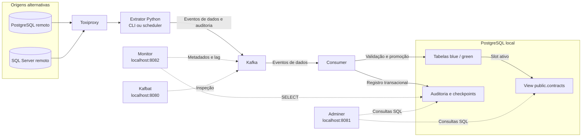
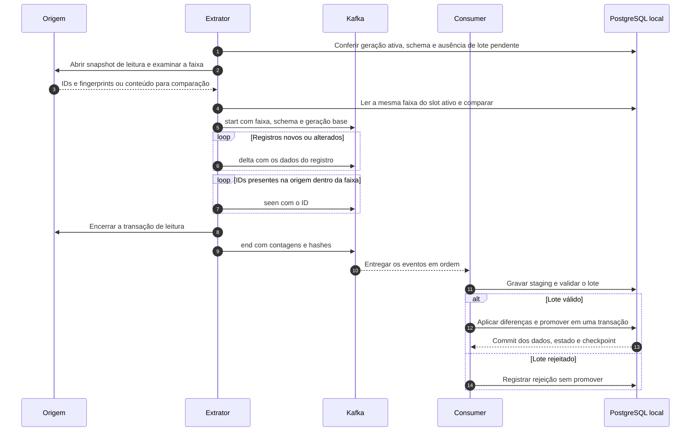
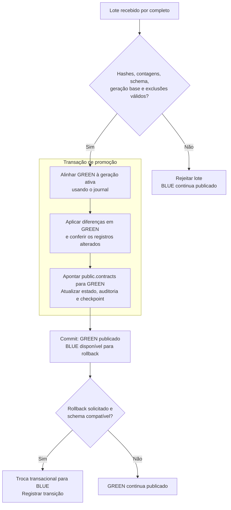
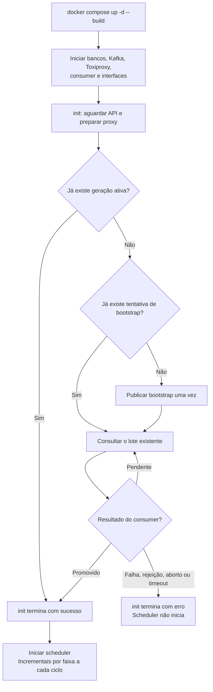
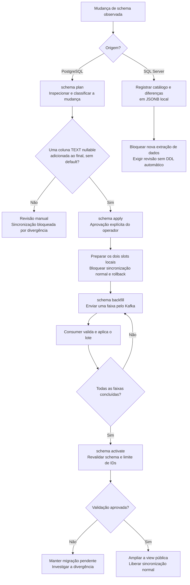

# Kafka Restore Lab

Laboratório de reconciliação de contratos de uma origem PostgreSQL ou SQL Server para um PostgreSQL local, usando Python, Kafka e duas tabelas blue-green. O extrator lê a origem com uma conta de leitura; o consumer valida cada lote antes de disponibilizá-lo pela view `public.contracts`.

O projeto demonstra carga inicial, sincronização por faixas de chave primária, detecção de exclusões físicas, rollback, inspeção de schema e testes de falhas de rede. Os bancos de origem do Compose contêm dados fictícios. O laboratório não foi homologado para produção nem para bases de centenas de gigabytes.

No cenário PostgreSQL padrão, `docker compose up -d --build` prepara o proxy, publica o bootstrap somente no destino ainda não inicializado, aguarda a promoção pelo consumer e inicia a reconciliação periódica. O monitor também sobe nesse comando.

## Como o fluxo funciona



As setas contínuas mostram o fluxo de dados; as pontilhadas indicam consultas das interfaces. PostgreSQL e SQL Server são cenários alternativos, cada um com seu destino de laboratório.

1. `bootstrap` lê todos os contratos e publica a carga inicial no Kafka. Só pode ser usado em um destino ainda sem geração ativa.
2. `incremental` examina uma faixa completa de IDs. Compara fingerprints SHA-256 e publica os dados dos registros novos ou alterados, além dos eventos `seen` com os IDs encontrados na origem.
3. O consumer recebe `start`, `delta`, `seen` e `end`, confere contagens, hashes e compatibilidade do schema e identifica exclusões pela ausência de IDs na faixa validada. Um evento `abort` encerra um lote interrompido.
4. Após validar o lote, o consumer alinha o slot inativo pelo journal, aplica as diferenças e troca a view pública dentro de uma transação. Um lote incompleto ou rejeitado não é promovido.
5. A auditoria registra a execução, as mudanças e as faixas promovidas. O monitor apresenta essas evidências sem consultar diretamente a origem.

No PostgreSQL, os fingerprints são calculados no banco e o extrator busca o conteúdo completo apenas dos registros divergentes. No SQL Server, o conteúdo de toda a faixa é lido pelo Python para gerar uma representação canônica. Nos dois casos, somente as diferenças seguem como payload de dados no Kafka; os eventos de presença também geram tráfego.

### Uma execução incremental



O retorno da CLI confirma a publicação dos eventos. A conclusão da sincronização depende do processamento pelo consumer e deve ser conferida pelo estado `promoted`.

### Promoção blue-green e rollback

O exemplo parte de BLUE ativo e GREEN em espera. Na próxima promoção, os papéis se invertem.



Uma falha durante a transação de promoção desfaz as alterações dessa transação. O rollback operacional seleciona a geração validada disponível no outro slot e não modifica a origem.

## Componentes e serviços

### Serviços do Docker Compose

Serviços sem profile iniciam com `docker compose up -d --build`. Os demais são opcionais, ativados pelo profile ou pela seleção explícita do serviço. `cli`, `seed-fixture`, `mssql-cli` e `mssql-fixture` são ferramentas executadas com `run --rm`.

| Serviço | Profile | Responsabilidade |
|---|---|---|
| `remote-db` | Padrão | PostgreSQL que simula a origem. Inicializa `lab_remote`, a tabela `public.contracts`, 10.000 contratos e a conta `remote_reader`. |
| `remote-sqlserver` | `mssql` | Origem SQL Server opcional. O banco e os contratos são preparados pelo `mssql-fixture`. |
| `local-db` | Padrão | PostgreSQL de destino. Mantém as tabelas blue-green, a view pública, staging, checkpoints, journal e auditoria no banco `lab_local`. |
| `kafka` | Padrão | Broker e controller em modo KRaft. Transporta eventos de dados e auditoria em tópicos separados, com uma partição por tópico. |
| `toxiproxy` | Padrão | Intermedeia a conexão com a origem e permite injetar latência, timeout, restrição de banda ou indisponibilidade. |
| `consumer` | Padrão | Processo contínuo que consome Kafka, valida os lotes, aplica diferenças e promove o slot local. |
| `cli` | `tools` | Interface de operação PostgreSQL: carga inicial, incremental, status, rollback, schema, catálogo e falhas de rede. |
| `seed-fixture` | `tools` | Gera ou altera dados fictícios no PostgreSQL remoto. É o serviço com credencial administrativa dessa origem para `seed` e `mutate`. |
| `init` | Padrão | Prepara o proxy e consulta o estado persistido. Publica o primeiro bootstrap ou retoma a espera de um lote existente. Só termina com sucesso após haver uma carga promovida. |
| `scheduler` | Padrão | Inicia após o sucesso de `init`. Executa incrementais PostgreSQL em sequência, com pausa de 60 segundos entre tentativas e faixas de 1.000 IDs. |
| `mssql-cli` | `mssql-tools` | Interface de extração e catálogo SQL Server. Usa `remote_reader`, representação canônica e o mesmo pipeline Kafka/consumer. |
| `mssql-fixture` | `mssql-tools` | Usa a conta administrativa do SQL Server fictício para criar banco, tabela, 100 contratos, conta de leitura e habilitar isolamento SNAPSHOT. Também oferece mutações de dados e DDL para testes. |
| `mssql-scheduler` | `mssql-scheduled` | Executa incrementais SQL Server com pausa de 60 segundos e faixas de 1.000 IDs. Exige fixture e bootstrap concluídos. |
| `monitor` | Padrão | Painel HTTP de saúde da reconciliação. Consulta auditoria com `monitor_reader` e metadados Kafka; não aplica correções. |
| `kafbat` | Padrão | Interface web para examinar brokers, tópicos, mensagens, grupos de consumidores e lag. |
| `adminer` | Padrão | Interface web para acessar o banco local e consultar dados, estruturas e auditoria. |

### Código e scripts

| Arquivo | Função |
|---|---|
| `docker-compose.yml` | Define serviços, profiles, conexões, portas, volumes e parâmetros do laboratório. |
| `app/Dockerfile` e `app/requirements.txt` | Constroem a imagem Python compartilhada e instalam os drivers PostgreSQL, Kafka e SQL Server. |
| `app/lab.py` | Entrada da CLI, extrator PostgreSQL, protocolo Kafka, consumer, blue-green, rollback, scheduler e comandos de fixture. |
| `app/startup.py` | Coordena a preparação do proxy e o bootstrap inicial, aguarda a promoção e impede republicação de uma tentativa já registrada. |
| `app/mssql_sync.py` | Adaptador de extração SQL Server: leitura SNAPSHOT, comparação por faixa e publicação no Kafka. |
| `app/canonical_contract.py` | Valida o contrato SQL Server e normaliza IDs, Unicode, valores nulos e decimais para comparação determinística. |
| `app/schema_evolution.py` | Inspeção e controle do schema PostgreSQL, planejamento de DDL, preparação local, backfill e ativação. |
| `app/source_catalog.py` | Captura e compara catálogos nativos e lógicos de PostgreSQL e SQL Server, mantendo histórico JSONB local. |
| `app/sqlserver_fixture.py` | Inicialização e mutações administrativas restritas ao SQL Server fictício. |
| `app/monitor.py` | Coleta sinais operacionais e fornece dashboard, detalhes de execuções e endpoints HTTP. |
| `sql/remote.sql` | Inicialização da origem PostgreSQL fictícia e concessão de leitura ao extrator. |
| `sql/local.sql` | Inicialização do destino, tabelas de controle, view pública e permissões do monitor. |
| `tests/` | Verificações offline e scripts de integração com Docker. |

## Requisitos

- Docker Engine ou Docker Desktop com o plugin Docker Compose e daemon em execução.
- Acesso à internet na primeira montagem para baixar imagens e dependências.
- Bash para executar as funções e os scripts de teste dos exemplos.
- Portas locais disponíveis conforme a tabela abaixo.
- Para SQL Server: CPU compatível com a imagem e memória suficiente para executar esse banco junto dos demais serviços.
- Python e as dependências de `tests/requirements.txt` para as verificações offline. A execução do laboratório usa o Python da imagem Docker.

Execute os comandos na raiz deste repositório, onde está `docker-compose.yml`.

| Acesso no host | Destino | Uso |
|---|---|---|
| `http://localhost:8080` | Kafbat | Inspeção do Kafka. |
| `http://localhost:8081` | Adminer | SQL e auditoria. |
| `http://localhost:8082` | Monitor | Saúde e progresso; incluído na subida padrão. |
| `localhost:55432` | PostgreSQL remoto | Banco `lab_remote`. |
| `localhost:55433` | PostgreSQL local | Banco `lab_local`. |
| `localhost:51433` | SQL Server remoto | Disponível no cenário SQL Server. |
| `localhost:9092` | Kafka | Conexão de clientes executados no host. |
| `http://localhost:8474` | API Toxiproxy | Controle dos proxies e das falhas simuladas. |

As portas publicadas estão vinculadas a `127.0.0.1`. Dentro da rede Docker, os serviços usam seus nomes e portas internas; por exemplo, `local-db:5432` e `kafka:19092`.

## Tutorial: PostgreSQL → Kafka → PostgreSQL

### 1. Iniciar os serviços

```bash
docker compose up -d --build
docker compose ps -a
```

O PostgreSQL executa os scripts SQL de inicialização somente na criação dos volumes. Em uma instalação nova, a origem recebe 10.000 contratos. O serviço `init` prepara o proxy, publica essa carga e aguarda o consumer. O scheduler depende de `init` com a condição `service_completed_successfully`, por isso só começa depois da promoção. O monitor fica disponível durante essa preparação.



É normal `init` aparecer como `Exited (0)` após concluir. Em novas subidas com os mesmos volumes, ele encontra a geração ativa e não republica o bootstrap. Se houver um bootstrap pendente, aguarda o mesmo lote. Uma tentativa registrada como falha, rejeitada ou abortada exige diagnóstico e recuperação pelo operador.

Por padrão, `init` espera até 60 segundos pela API do proxy e até 600 segundos pela promoção após a publicação. Ajuste `--ready-timeout` e `--promotion-timeout` no comando do serviço se necessário. Um timeout não apaga nem republica o lote.

### 2. Conferir a carga inicial

```bash
docker compose run --rm cli status
docker compose logs --tail 100 init scheduler consumer
```

A carga inicial já foi publicada automaticamente. Confira o bootstrap como `promoted`; as execuções seguintes serão incrementais do scheduler. `extracting` e `loading` indicam trabalho ainda pendente. Não execute `bootstrap` novamente em um destino com geração ativa.

Confira o resultado no banco local:

```bash
docker compose exec -T local-db psql -U postgres -d lab_local -c \
  'SELECT COUNT(*) FROM public.contracts;'
```

Em volumes novos e sem outras mutações, o resultado esperado é `10000`.

### 3. Simular inclusão, alteração e exclusão

Os comandos abaixo modificam exclusivamente a origem fictícia do laboratório. Para controlar a faixa manualmente, pare o scheduler e confirme em `status` que não há lote pendente. Ao receber a parada, ele termina a publicação em andamento antes de sair; aguarde também o consumer promover esse lote. Execute o conjunto uma vez sobre os dados iniciais:

```bash
docker compose stop scheduler
docker compose run --rm cli status

docker compose run --rm seed-fixture mutate update 1
docker compose run --rm seed-fixture mutate hard-delete 2
docker compose run --rm seed-fixture mutate insert 10001

# Faixa de demonstração que inclui os três IDs alterados.
docker compose run --rm cli incremental --from-id 1 --sweep-width 11000
docker compose run --rm cli status
```

Após a promoção, são esperadas uma inclusão, uma atualização e uma exclusão. A contagem permanece em 10.000; o contrato `1` tem seu valor acrescido de `42`, o `2` desaparece e o `10001` passa a existir.

```bash
docker compose exec -T local-db psql -U postgres -d lab_local -c \
  'SELECT id, amount FROM public.contracts WHERE id IN (1, 2, 10001) ORDER BY id;'
```

O tamanho da faixa conta posições de IDs, não linhas existentes. Uma alteração fora da faixa só aparece depois que uma execução examinar seu ID.

### 4. Continuar a varredura

```bash
# Sem --from-id, retoma next_sweep_id; volta ao início ao superar o maior ID.
docker compose run --rm cli incremental --sweep-width 1000

# Aguarde esse lote aparecer como promoted antes de retomar o scheduler.
docker compose up -d scheduler
docker compose logs -f scheduler consumer
```

O serviço `init` cuida do bootstrap; o scheduler executa apenas incrementais. A pausa de 60 segundos é somada ao tempo de cada tentativa. Para retomar os exercícios manuais, interrompa-o e aguarde qualquer lote pendente concluir:

```bash
docker compose stop scheduler
docker compose run --rm cli status
```

### 5. Testar rollback

Depois de uma promoção incremental, com o scheduler parado e sem lote pendente:

```bash
docker compose run --rm cli rollback
docker compose run --rm cli status
```

O rollback seleciona a geração validada disponível no outro slot. Ele exige schema compatível e não altera a origem. Para reaplicar o estado remoto do exemplo, execute novamente o incremental que cobre os IDs alterados e aguarde a promoção.

## Tutorial: SQL Server → Kafka → PostgreSQL

Este cenário usa um destino próprio: não faça um segundo bootstrap no destino já carregado pelo tutorial PostgreSQL. O exemplo abaixo usa outro nome de projeto para separar os volumes. Como as portas são as mesmas, pare o cenário PostgreSQL antes de iniciar o SQL Server.

```bash
docker compose stop

# Função Bash: mantenha este prefixo em todas as operações deste cenário.
mssql_lab() {
  docker compose -p kafka-restore-sqlserver \
    --profile mssql --profile mssql-tools "$@"
}

mssql_lab up -d --build \
  remote-sqlserver remote-db local-db kafka toxiproxy consumer kafbat adminer monitor

# Apenas a fixture usa a conta administrativa do SQL Server fictício.
mssql_lab run --rm mssql-fixture init
mssql_lab run --rm mssql-cli chaos init --target sqlserver
mssql_lab run --rm mssql-cli bootstrap
mssql_lab run --rm mssql-cli status
```

Aguarde `promoted` antes da próxima etapa. A fixture cria 100 contratos em `dbo.contracts`, habilita `ALLOW_SNAPSHOT_ISOLATION` e prepara `remote_reader` com leitura. O serviço `remote-db` também sobe porque é dependência do Toxiproxy no Compose; a extração deste cenário usa o SQL Server. A lista explícita de serviços deixa `init` e `scheduler` PostgreSQL desligados. Neste cenário opcional, a preparação da fixture e o bootstrap continuam manuais.

```bash
mssql_lab run --rm mssql-fixture mutate-insert
mssql_lab run --rm mssql-fixture mutate-update
mssql_lab run --rm mssql-fixture mutate-delete
mssql_lab run --rm mssql-cli incremental --from-id 1 --sweep-width 200
mssql_lab run --rm mssql-cli status
```

Após a promoção, o destino permanece com 100 contratos: o ID `1` foi atualizado, o `2` foi removido e o `101` foi incluído. As interfaces usam os mesmos endereços da tabela de acessos.

Para automatizar após o bootstrap:

```bash
mssql_lab --profile mssql-scheduled up -d --build mssql-scheduler
mssql_lab logs -f mssql-scheduler consumer
# Pare antes de executar incrementais ou experimentos manuais.
mssql_lab --profile mssql-scheduled stop mssql-scheduler
```

O leitor exige isolamento transacional `SNAPSHOT`; se estiver desabilitado, a extração é recusada. `READ COMMITTED` e `NOLOCK` não substituem essa exigência. O adaptador suporta o contrato de cinco colunas (`id`, `contract_code`, `amount`, `status`, `description`), PK `BIGINT` positiva, texto Unicode e valor monetário decimal com duas casas. O limite padrão de faixa é 100.000 IDs, definido por `MAX_SQLSERVER_SWEEP_WIDTH`.

## Monitoramento e auditoria

Abra `http://localhost:8082`. O painel atualiza a cada 15 segundos e reúne:

| Sinal | Evidência e interpretação |
|---|---|
| Origem | Última extração, motor e falhas registradas em `replica.sync_runs`; a disponibilidade atual da origem não é sondada. |
| Extração | Lotes pendentes, rejeitados, com falha ou sem conclusão dentro do tempo esperado. |
| Kafka e consumer | Acesso ao broker, tópicos de dados e auditoria, membros do grupo, offsets e lag. |
| Destino e blue-green | Acessibilidade do PostgreSQL local, slot ativo, gerações e histórico de promoção/rollback. |
| Integridade e exclusões | Contadores de inserção, atualização e exclusão dos lotes promovidos. |
| DDL | Hash ativo, migração pendente, progresso do backfill e observações do catálogo por origem. |
| Cobertura | União dos intervalos numéricos promovidos na janela configurada e na linhagem atual. |

| Endpoint | Finalidade |
|---|---|
| `/` | Dashboard HTML. |
| `/run/<UUID>` | Detalhes de uma execução. |
| `/status.json` | Estado consolidado em JSON. |
| `/healthz` | Liveness: confirma que o processo HTTP do monitor responde. |
| `/readyz` | Prontidão das dependências: HTTP 200 se Kafka e PostgreSQL local estiverem acessíveis; 503 em caso de falha. |

```bash
curl -fsS http://localhost:8082/status.json
curl -i http://localhost:8082/healthz
curl -i http://localhost:8082/readyz
```

No Adminer, selecione PostgreSQL, servidor `local-db`, banco `lab_local`, usuário `postgres` e senha `lab-admin`. Para verificar a auditoria:

```sql
SELECT run_id, mode, status, inserted_count, updated_count, deleted_count, error
FROM replica.sync_runs
ORDER BY started_at DESC LIMIT 15;

SELECT * FROM replica.active_state;
SELECT * FROM replica.slot_state;
SELECT * FROM replica.transitions ORDER BY id DESC LIMIT 15;

SELECT run_id, sweep_low, sweep_high, target_max_id, source_engine, checked_at
FROM replica.range_checkpoints
ORDER BY checked_at DESC LIMIT 15;
```

As tabelas `replica.blue_contracts` e `replica.green_contracts` guardam os dados físicos. `replica.generations` registra a linhagem; `replica.change_journal`, as imagens anteriores e posteriores usadas para alinhar slots; `replica.ingest_delta`, `replica.ingest_keys` e `replica.ingest_deep`, o staging de ingestão. Consulte `public.contracts` para ler os dados publicados.

### Ajustar os alertas

Edite o ambiente de `monitor` em `docker-compose.yml` e recrie o serviço com `docker compose up -d monitor`.

| Variável | Padrão | Efeito |
|---|---|---|
| `LAB_STALLED_MINUTES` | `15` | Tempo para considerar um lote sem conclusão como travado. |
| `LAB_COVERAGE_WINDOW_HOURS` | `24` | Janela móvel usada para calcular cobertura. |
| `LAB_MAX_COVERAGE_INTERVALS` | `20000` | Limite de intervalos consultados pelo painel. |
| `LAB_MAX_CONSUMER_LAG` | `1000` | Limite de mensagens atrasadas para alertar. |
| `LAB_EXPECTED_INTERVAL_MINUTES` | `0` | Desabilita expectativa de promoção periódica. Configure um limite apenas se houver agendamento ativo. |
| `LAB_CONSUMER_GROUP` | Definido no Compose | Grupo Kafka observado; deve corresponder ao grupo usado pelo consumer. |

`unknown` significa ausência de evidência. Lag zero não comprova igualdade com a origem; uma promoção recente não comprova cobertura completa. `operational` indica que os sinais observados não geraram alertas. O monitor não consulta os dados completos da tabela ativa a cada atualização e não envia alertas externos.

A cobertura mede o espaço numérico entre `1` e o maior ID registrado. IDs esparsos podem produzir um percentual diferente da proporção de linhas conferidas. Checkpoints são gravados na mesma transação da promoção; lotes rejeitados e gerações fora da linhagem após rollback não somam cobertura. Sem limite superior conhecido, a cobertura permanece não aferida. Scans em momentos diferentes não constituem um snapshot global.

## Mudanças de estrutura e catálogo



### PostgreSQL: planejar, preparar, preencher e ativar

Execute este exercício com o scheduler parado, após um bootstrap PostgreSQL e sem lote pendente. O primeiro comando altera administrativamente apenas a origem fictícia:

```bash
docker compose exec -T remote-db psql -v ON_ERROR_STOP=1 -U postgres -d lab_remote -c \
  'ALTER TABLE public.contracts ADD COLUMN currency_code TEXT;'

docker compose run --rm cli schema plan
docker compose run --rm cli schema apply
docker compose run --rm cli schema backfill --sweep-width 1000
docker compose run --rm cli schema status
```

`schema plan` inspeciona a mudança. `schema apply` representa a aprovação explícita do operador e prepara os dois slots locais. A única mudança elegível é adicionar uma coluna `TEXT` nullable no final da tabela, sem default.

Repita `schema backfill` e consulte `schema status`, aguardando o consumer concluir cada lote, até todas as faixas estarem validadas. O backfill transporta os valores da nova coluna via Kafka. Durante a migração, a sincronização normal e o rollback ficam bloqueados; a view pública mantém o contrato anterior.

```bash
# Somente após a conclusão de todas as faixas:
docker compose run --rm cli schema activate
docker compose run --rm cli incremental --from-id 1 --sweep-width 1000
```

A ativação confere novamente o schema e o limite de IDs antes de ampliar a view. Renomear ou remover colunas, mudar tipos, nulabilidade, PK, constraints ou índices exige revisão manual.

### SQL Server: observar e bloquear mudanças inesperadas

Usando a função `mssql_lab` do tutorial:

```bash
mssql_lab run --rm mssql-cli catalog observe --engine sqlserver --source-key mssql-dbo-contracts
mssql_lab run --rm mssql-fixture add-column
mssql_lab run --rm mssql-cli catalog observe --engine sqlserver --source-key mssql-dbo-contracts
mssql_lab run --rm mssql-cli catalog history --source-key mssql-dbo-contracts
```

Depois do `add-column`, uma nova extração de dados deve ser bloqueada por divergência de schema. Não há migração automática de DDL SQL Server para PostgreSQL. A geração publicada permanece disponível.

`replica.source_catalog_observations` preserva `native_manifest`, `logical_manifest`, hashes e diferenças. O catálogo nativo inclui detalhes como tamanho, precisão, collation, índices e constraints conforme a visibilidade da conta. O lógico organiza as colunas por nome para comparação. As observações representam o estado encontrado, não todos os comandos DDL executados entre leituras.

O controle de evolução PostgreSQL usa `replica.schema_versions`, `replica.schema_state` e `replica.schema_changes`. As tabelas `replica.schema_backfill_runs`, `replica.schema_backfill_values` e `replica.schema_backfill_intervals` registram lotes, valores em staging e faixas concluídas.

## Simular falhas e recuperar o processamento

Com o scheduler parado, teste a conexão PostgreSQL:

```bash
docker compose run --rm cli chaos latency 300
docker compose run --rm cli incremental --from-id 1 --sweep-width 1000
# Aguarde a conclusão antes do próximo lote.
docker compose run --rm cli chaos clear

docker compose run --rm cli chaos down
# Deve falhar sem promover outro slot.
docker compose run --rm cli incremental --from-id 1 --sweep-width 1000
docker compose run --rm cli chaos up
```

No SQL Server, use `mssql_lab run --rm mssql-cli chaos ... --target sqlserver`. `chaos status` mostra o proxy; `chaos clear` remove as falhas injetadas e reabilita a conexão. A CLI também oferece `timeout` e `bandwidth`.

Para observar o consumo assíncrono, pare `consumer`, execute um incremental, confira que a geração ativa ainda não mudou e volte a iniciar o serviço. O consumer retoma o consumo pelos offsets confirmados. Aguarde a promoção antes de publicar outro lote.

| Situação | Diagnóstico e ação |
|---|---|
| `Previous batch pending` | Consulte `status`, logs e mensagens no Kafbat. Resolva o lote anterior antes de iniciar outro. |
| Lote `extracting` ou `loading` por muito tempo | Verifique consumer, Kafka, evento `end` e erros do extrator. A duração sozinha não autoriza descartar o lote. |
| Lote `rejected` | Leia `error` em `replica.sync_runs`. Pode haver divergência de hash, geração base ou limite de exclusão. |
| `init` com erro e scheduler sem iniciar | Confira os logs de `init` e consumer. Um bootstrap pendente será reutilizado; uma tentativa terminal não será republicada automaticamente. Após resolver a causa, execute `docker compose up -d init scheduler`. |
| Exclusões bloqueadas | `MAX_REMOVE_FRACTION`, configurado no **consumer**, limita a fração removida na faixa e no total local; padrão `0.20`. Investigue a origem antes de ajustar. |
| Schema divergente | Consulte `schema plan` no PostgreSQL ou o histórico de catálogo SQL Server; siga o procedimento de revisão. |
| Monitor ou `init` com erro de tabela/permissão | Confira os logs de inicialização do banco e o schema do volume. Scripts de inicialização não são reaplicados em volumes existentes. |
| Origem indisponível | Confira logs, estado do proxy e credenciais. Use `chaos clear` para encerrar a simulação. |

```bash
docker compose logs --tail 100 consumer local-db kafka toxiproxy
docker compose logs --tail 100 monitor init scheduler
```

Para um lote realmente abandonado, a CLI oferece `abandon --run-id <UUID> --force` e `schema abandon --run-id <UUID> --force` para backfill. Antes de usar, confirme que não há produtor ativo nem evento `end` já publicado ou em fila. Esses comandos publicam um aborto ordenado; não desfazem uma promoção que já ocorreu.

## Configuração, persistência e manutenção

As conexões e opções estão no ambiente dos serviços em `docker-compose.yml`:

| Variável | Finalidade |
|---|---|
| `REMOTE_DSN` | Conexão PostgreSQL de leitura via Toxiproxy. |
| `REMOTE_DIRECT_DSN` | Conexão direta de leitura usada pelo gerador de carga PostgreSQL. |
| `LOCAL_DSN` | Conexão ao destino; o monitor usa a conta restrita `monitor_reader`. |
| `KAFKA_BOOTSTRAP` | Endereço interno do broker. |
| `KAFKA_TOPIC` e `KAFKA_AUDIT_TOPIC` | Tópicos de dados e auditoria. Preserve a configuração de todos os participantes ao reutilizar volumes. |
| `TOXIPROXY_URL` | API de controle das falhas simuladas. |
| `REMOTE_ENGINE` | Seleciona o extrator PostgreSQL ou SQL Server. |
| `MSSQL_HOST`, `MSSQL_PORT`, `MSSQL_DATABASE`, `MSSQL_USER`, `MSSQL_PASSWORD` | Conexão SQL Server de leitura. |
| `MSSQL_SCHEMA` e `MSSQL_TABLE` | Objeto SQL Server inspecionado; padrões `dbo` e `contracts`. O contrato de dados continua restrito às cinco colunas suportadas. |
| `REMOTE_ADMIN_DSN` e `MSSQL_SA_PASSWORD` | Credenciais administrativas das fixtures. Não devem ser fornecidas aos extratores. |

As senhas do Compose são de laboratório: `lab-admin` para o administrador PostgreSQL, `lab-reader` para leitores da origem e `monitor-reader` para o monitor. Kafbat, Adminer e monitor não possuem uma camada de autenticação de produção neste projeto.

Os volumes `remote_data`, `local_data`, `kafka_data` e `mssql_data` persistem os bancos e o Kafka. O projeto Compose padrão se chama `kafka-restore-lab`; o tutorial SQL Server usa `kafka-restore-sqlserver`. Mudar o nome do projeto cria outro conjunto de volumes. Use o mesmo prefixo de projeto em todas as operações do cenário.

### Reutilizar um volume local

Scripts em `docker-entrypoint-initdb.d` não são executados novamente em volumes inicializados. O serviço `init` usa `replica.active_state` e `replica.sync_runs` para decidir se precisa da primeira carga; ele não executa migrações de schema nem recria tabelas existentes.

Com um volume já inicializado corretamente, basta usar o mesmo nome de projeto e subir o ambiente:

```bash
docker compose up -d --build
docker compose run --rm cli status
```

Se faltarem tabelas de controle ou houver inconsistência entre gerações e estado ativo, a inicialização falha e impede a subida do scheduler. Inspecione os logs e planeje o reparo SQL do volume antes de tentar novamente. Não reaplique `sql/local.sql` inteiro sobre um banco existente e não apague volumes com dados necessários.

O monitor precisa de leitura em `replica.generations` para calcular a cobertura por linhagem. Instalações novas já recebem essa permissão. Se um volume existente apresentar `permission denied for table generations` no painel, aplique a concessão local:

```bash
docker compose exec -T local-db psql -v ON_ERROR_STOP=1 -U postgres -d lab_local -c \
  'GRANT SELECT ON replica.generations TO monitor_reader;'
```

Se a primeira tentativa de bootstrap terminou em `failed`, `rejected` ou `aborted`, resolva a causa antes de publicar uma nova carga manualmente com `docker compose run --rm cli bootstrap`. Depois, execute `docker compose up -d init scheduler` para aguardar a promoção e liberar os incrementais. Para lotes ainda pendentes, não publique outro bootstrap: retome o consumer e a inicialização, que aguardará o lote já registrado.

### Parar e retomar

```bash
# Cenário PostgreSQL: preserva os volumes.
docker compose stop

# Retoma o ambiente; init reutiliza a carga e libera o scheduler.
docker compose up -d --build
```

Para o cenário SQL Server, pare com `mssql_lab --profile mssql-scheduled stop` e retome os serviços usando o mesmo comando `mssql_lab up` do tutorial, sem executar fixture ou bootstrap novamente. `docker compose down` remove containers e rede, preservando os volumes nomeados; `docker compose down -v` também apaga os dados persistidos.

## Verificações e testes

As verificações abaixo não precisam de Docker, Kafka ou bancos ativos. Instale `tests/requirements.txt` no seu ambiente Python e execute:

```bash
python3 tests/check_static.py
python3 tests/test_reconcile.py
python3 tests/test_generation_paths.py
python3 tests/test_schema_contract.py
python3 tests/test_source_catalog.py
python3 tests/test_mssql_contract.py
python3 tests/test_mssql_paths.py
python3 tests/test_monitor.py
python3 tests/test_startup.py
```

Os testes cobrem contratos, hashes, caminhos de geração/rollback, evolução de schema, catálogo e regras do monitor com simulações. Não substituem os testes com bancos reais.

Com o cenário PostgreSQL inicializado e o monitor ativo, há um smoke test de leitura:

```bash
LAB_MONITOR_SMOKE=1 bash tests/e2e_monitor.sh
```

O teste de inicialização cria projetos próprios sem portas publicadas e remove somente esses volumes ao terminar. Verifica a subida padrão, bootstrap único, promoção anterior aos incrementais, monitor, reinício e retomada de bootstrap pendente:

```bash
LAB_STARTUP_TEST=1 bash tests/e2e_startup.sh
```

Os testes de integração seguintes **alteram dados e estruturas**. `e2e_schema.sh` e `e2e_sqlserver_sync.sh` também removem os volumes do projeto. Execute-os somente em um projeto descartável, com portas disponíveis; cada comando abaixo cria um cenário separado:

```bash
COMPOSE_PROJECT_NAME=kafka-test-reconcile bash tests/e2e.sh
COMPOSE_PROJECT_NAME=kafka-test-schema LAB_RESET=1 bash tests/e2e_schema.sh
COMPOSE_PROJECT_NAME=kafka-test-catalog LAB_SQLSERVER_TEST=1 bash tests/e2e_sqlserver_catalog.sh
COMPOSE_PROJECT_NAME=kafka-test-sqlserver LAB_RESET=1 bash tests/e2e_sqlserver_sync.sh
```

Pare ou remova cada cenário antes de executar o seguinte, pois os projetos publicam as mesmas portas. Esses scripts não devem compartilhar volumes com o tutorial ou com dados que você queira preservar.

## Limites do experimento

- Sem `updated_at`, `deleted_at`, CDC ou logs de mudança, a detecção depende da leitura das faixas. Alterações posteriores à leitura de uma faixa precisam de outro ciclo.
- O escopo é uma tabela de contratos, PK numérica e um tópico de dados com partição única. Não replica automaticamente um banco inteiro, sequences, roles, grants, FKs ou índices arbitrários.
- A extração SQL Server lê todo o conteúdo da faixa para calcular os hashes em Python. A redução de payload no Kafka não elimina o custo de leitura e rede entre origem e extrator.
- Bootstrap e faixas grandes podem exigir memória, disco e tempo significativos. O destino mantém duas cópias físicas dos contratos, além de staging, journal e índices.
- Blue-green ocorre em duas tabelas da mesma instância PostgreSQL. Rollback depende da geração disponível e da compatibilidade do schema; não substitui backup nem alta disponibilidade física.
- O monitor oferece sinais operacionais locais. Não certifica igualdade simultânea da base inteira, disponibilidade atual da origem ou RPO global.
