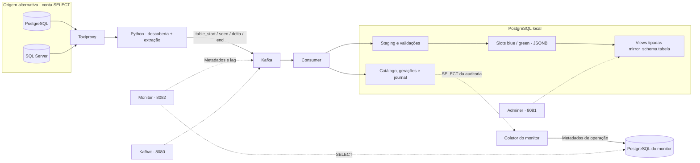
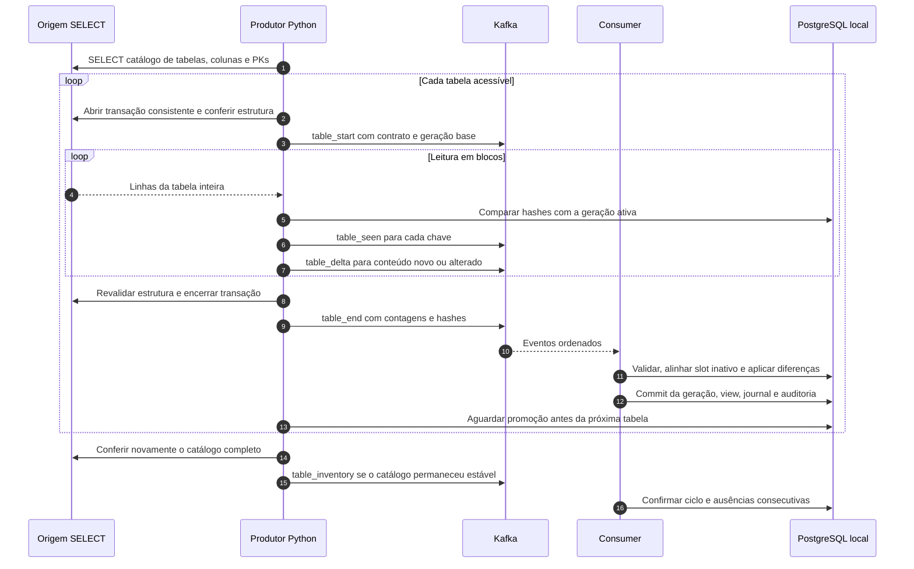

# Kafka Restore Lab

Laboratório de descoberta e reconciliação de tabelas de uma origem PostgreSQL ou SQL Server para PostgreSQL local, com Python, Kafka e publicação blue-green por tabela. A aplicação usa uma conta com **SELECT na origem**: não instala triggers, não habilita CDC, não cria tabelas de controle remotas e não executa DDL ou DML remoto.

```bash
cp .env.example .env
docker compose up -d --build
```

Faça a cópia apenas na primeira configuração, preservando um `.env` já existente. Edite esse arquivo para ajustar os padrões do laboratório. Veja [Arquivos de ambiente](#arquivos-de-ambiente).

Esse comando inicia o cenário PostgreSQL, prepara o proxy, descobre as tabelas, publica o bootstrap das tabelas ainda não inicializadas, aguarda a promoção pelo consumer e inicia o scheduler. O monitor faz parte do conjunto padrão: [localhost:8082](http://localhost:8082).

Os bancos de origem do Compose são fixtures com dados fictícios. A reconciliação padrão **lê integralmente cada tabela a cada ciclo**. O laboratório não foi homologado para produção ou bases de centenas de gigabytes.

## Arquivos de ambiente

O Compose interpola as variáveis de `.env` no `docker-compose.yml` e envia a cada serviço apenas as entradas declaradas no seu `environment`. Não há carregamento de dotenv pelo Python. O YAML mantém os valores padrão, permitindo iniciar as fixtures mesmo sem o arquivo local.

| Arquivo | Uso |
| --- | --- |
| `.env.example` | Modelo versionado dos padrões de portas, credenciais das fixtures, sincronização e monitoramento. |
| `.env` | Configuração local lida automaticamente pelo Compose; ignorada pelo Git. |

Toda a configuração local fica em `.env`, sem argumentos adicionais nos comandos:

```bash
docker compose config --quiet
docker compose up -d --build
docker compose run --rm cli discover status
docker compose logs --tail 30 scheduler consumer
```

Variáveis já exportadas no shell têm prioridade sobre `.env`. O arquivo configura o Compose, com nomes de serviços da rede Docker; não é um ambiente para executar a aplicação diretamente no host.

| Configuração | Variáveis |
| --- | --- |
| Portas no host | `REMOTE_DB_HOST_PORT`, `LOCAL_DB_HOST_PORT`, `MSSQL_HOST_PORT`, `KAFKA_HOST_PORT`, `TOXIPROXY_HOST_PORT`, `KAFBAT_HOST_PORT`, `ADMINER_HOST_PORT`, `MONITOR_HOST_PORT`. |
| Administração das fixtures | `REMOTE_ADMIN_PASSWORD`, `LOCAL_ADMIN_PASSWORD`, `MONITOR_ADMIN_PASSWORD`, `MSSQL_SA_PASSWORD`. |
| Descoberta e proteção | `SOURCE_SCHEMAS`, `MAX_REMOVE_FRACTION`, `SCHEDULER_INTERVAL_SECONDS`, `INIT_PROMOTION_TIMEOUT_SECONDS`. |
| Kafka e proxy | `KAFKA_BOOTSTRAP`, `KAFKA_TOPIC`, `KAFKA_AUDIT_TOPIC`, `TOXIPROXY_URL`. |
| Origem SQL Server | `MSSQL_HOST`, `MSSQL_PORT`, `MSSQL_USER`, `MSSQL_PASSWORD`, `MSSQL_DATABASE`. |
| Painel e coletor | Variáveis `LAB_*` descritas em [Monitor: como interpretar](#monitor-como-interpretar). |

As portas internas permanecem fixas. Por exemplo, `MONITOR_HOST_PORT=8182` muda o acesso para `http://localhost:8182`, enquanto o processo e seu healthcheck continuam na porta 8082 do container. `KAFKA_HOST_PORT` também atualiza o endereço anunciado para clientes no host; os containers continuam usando `kafka:19092`.

As senhas fornecidas são públicas e exclusivas das fixtures descartáveis. Os nomes dos bancos e as contas de leitura/escrita provisionadas continuam definidos em `sql/remote.sql`, `sql/local.sql`, `sql/monitor.sql` e `app/sqlserver_fixture.py`. Alterar `MSSQL_PASSWORD` muda a conexão, sem alterar a senha do login na origem. Alterar uma senha administrativa em `.env` também não muda a senha já gravada num volume: atualize a conta no banco antes de recriar os serviços com o novo valor. `LOCAL_ADMIN_PASSWORD` alimenta tanto `local-db` quanto as conexões administrativas da aplicação.

`REMOTE_DSN` e `REMOTE_DIRECT_DSN` podem sobrescrever as conexões PostgreSQL completas; os exemplos estão em `.env.example` e podem ser definidos em `.env`. O proxy `remote_pg` é criado com upstream `remote-db:5432`: alterar o DSN direto não reconfigura esse proxy. As credenciais administrativas da origem continuam restritas ao banco e aos serviços de fixture; o produtor recebe somente as credenciais SELECT da origem.

Depois de editar a configuração, use `docker compose config --quiet` para validar e `docker compose up -d` para recriar os serviços afetados. `restart` não carrega novas variáveis. A forma sem `--quiet` exibe a configuração resolvida, incluindo senhas.

O build usa `./app` como contexto. Por isso, as exclusões ficam em `app/.dockerignore`, que remove caches Python, ambientes virtuais, logs e arquivos `.env*` do contexto enviado ao builder. Os arquivos de ambiente da raiz já ficam fora desse contexto. O Dockerfile copia explicitamente os arquivos necessários à aplicação.

## Arquitetura



Cada tabela tem um contrato de colunas, uma chave, suas próprias gerações e um slot ativo. As views ficam em `mirror_<schema da origem>.<tabela>`, por exemplo `mirror_public.contracts` e `mirror_dbo.invoices`. Nomes de schema ou tabela muito longos recebem um sufixo derivado do nome original para evitar colisões.

A view legada `public.contracts` continua disponível para os comandos antigos, mas **não é o destino do fluxo padrão de descoberta**. Uma instalação existente passa a ter as novas views sem apagar os dados anteriores.

### O que acontece em cada ciclo



Com PK simples ou composta, cada linha recebe uma identidade derivada dos valores da chave. O produtor lê todo o conteúdo remoto para comparar hashes; envia pelo Kafka os eventos de presença e os payloads divergentes. Isso reduz payloads de dados, **não a leitura da origem**.

Sem PK, publica uma cópia completa por ciclo, incluindo duplicatas, com identidade interna por posição. O resultado representa o snapshot, mas não permite atribuir de forma confiável cada diferença a INSERT, UPDATE ou DELETE. Nesses lotes, as contagens individuais ficam desconhecidas após o bootstrap.

### Operações atendidas

| Operação na origem | Comportamento do fluxo padrão |
| --- | --- |
| CREATE TABLE desconhecida | Descoberta no próximo catálogo, desde que visível e acessível à conta de leitura; gera nova view após bootstrap validado. |
| INSERT em tabela nova ou conhecida | Publicado após leitura e validação da tabela. |
| UPDATE | Conteúdo divergente substitui a linha da mesma PK. Sem PK, nova cópia completa. |
| DELETE físico | A ausência de uma chave na leitura completa remove a linha do destino, respeitando a guarda de exclusão. |
| ADD / DROP COLUMN | Mudança de contrato exige cópia completa e recriação transacional da view. |
| ALTER COLUMN | Detecta mudanças observáveis no tipo, tamanho, precisão, escala, nulabilidade e collation; valida a conversão local antes de publicar. |
| DROP TABLE | Após dois ciclos com catálogos completos e estáveis sem o objeto, remove apenas a view gerenciada; mantém dados internos e histórico. |

Uma mudança estrutural usa o slot inativo. Se a conversão, a validação ou a substituição da view falhar, a publicação anterior permanece disponível. Dependências externas podem impedir a troca de schema: usamos `RESTRICT`, sem apagar objetos dependentes. Objetos locais sem a marca de propriedade do laboratório não são sobrescritos.

O status de retirada é `missing_or_inaccessible`: com SELECT e metadados limitados, a ausência pode significar DROP **ou perda de visibilidade/permissão**. Uma tabela ainda visível no catálogo, mas sem SELECT, fica `inaccessible`, gera alerta e preserva a última publicação. Falhas de conexão, erro ao ler o catálogo ou catálogo diferente entre o início e o fim do ciclo não autorizam uma decisão de retirada. No SQL Server, a visibilidade dos metadados depende das permissões sobre os objetos, conforme a [documentação da Microsoft](https://learn.microsoft.com/en-us/sql/relational-databases/security/metadata-visibility-configuration?view=sql-server-ver16).

## Acesso à origem e consistência

A conta de extração precisa conectar ao banco e executar SELECT nas tabelas desejadas, inclusive nas criadas depois. No PostgreSQL também precisa de USAGE nos schemas. `SOURCE_SCHEMAS`, quando definido, limita a descoberta a uma lista de schemas separados por vírgula. Mantenha esse escopo estável: retirar um schema do filtro fará suas tabelas anteriormente conhecidas entrarem no fluxo de ausência.

A aplicação não concede permissões remotas. O administrador da origem deve provisioná-las. As fixtures incluem configurações administrativas apenas para facilitar os testes:

- PostgreSQL: `remote_reader` recebe SELECT na tabela inicial e permissões padrão para tabelas futuras criadas pelo administrador da fixture em `public`. Isso não abrange automaticamente outros proprietários ou schemas.
- SQL Server: `remote_reader` recebe SELECT no schema `dbo`, sem permissões de escrita ou administração.
- Scripts de inicialização do PostgreSQL só executam em volumes novos. Num volume antigo, o administrador da fixture pode precisar conceder SELECT nas novas tabelas; o sincronizador não fará isso.

No PostgreSQL, a leitura usa `REPEATABLE READ READ ONLY`. No SQL Server, usa SNAPSHOT quando já habilitado; caso contrário, SERIALIZABLE. Não executa `ALTER DATABASE` para habilitar isolamento. SERIALIZABLE mantém bloqueios de leitura até o fim da transação e pode bloquear escritores; considere esse custo ao dimensionar a leitura, conforme a [documentação de isolamento do SQL Server](https://learn.microsoft.com/en-ie/sql/t-sql/statements/set-transaction-isolation-level-transact-sql?view=sql-server-ver16).

`BEGIN`, `SET` de sessão e `COMMIT`/`ROLLBACK` controlam a transação de leitura; não exigem permissão de escrita sobre os dados. As consultas de catálogo e conteúdo são SELECT. Cada tabela usa uma transação independente: não há snapshot simultâneo de todo o banco.

## Tutorial PostgreSQL

Requisitos: Docker Engine ou Docker Desktop com Compose que suporte `!reset` para os testes isolados; portas locais disponíveis e memória para Kafka e os bancos. As interfaces são publicadas somente em `127.0.0.1`.

### 1. Iniciar e conferir

```bash
docker compose up -d --build
docker compose ps -a
docker compose logs --tail 30 init scheduler consumer
docker compose run --rm cli discover status
```

`init` deve terminar com código zero. O scheduler depende desse sucesso e executa ciclos com intervalo de 60 segundos por padrão (`SCHEDULER_INTERVAL_SECONDS`) **após concluir o ciclo anterior**. Reiniciar a aplicação não repete bootstrap de tabelas já inicializadas; compara a publicação existente. Tabelas novas recebem seu próprio bootstrap.

```bash
docker compose exec local-db psql -U postgres -d lab_local -c 'SELECT count(*) FROM mirror_public.contracts;'
```

A fixture inicial contém 10.000 contratos. Consulte o monitor, o [Kafbat](http://localhost:8080) e o [Adminer](http://localhost:8081), nas portas padrão. No Adminer: sistema PostgreSQL, servidor `local-db`, usuário `postgres`, senha definida em `LOCAL_ADMIN_PASSWORD` (padrão `lab-admin`), banco `lab_local`.

### 2. Descobrir uma tabela e sincronizar alterações

As operações de escrita abaixo são executadas pelo administrador **da fixture descartável**, não pela conta de extração.

```bash
docker compose exec -T remote-db psql -v ON_ERROR_STOP=1 -U postgres -d lab_remote <<'SQL'
CREATE TABLE public.invoices (
  id BIGINT PRIMARY KEY,
  description TEXT,
  amount NUMERIC(14,2)
);
INSERT INTO public.invoices SELECT g, 'item ' || g, g FROM generate_series(1,10) g;
SQL
```

Aguarde o próximo ciclo ou pare o scheduler para executar ciclos manuais, evitando dois produtores simultâneos:

```bash
docker compose stop scheduler
docker compose run --rm cli discover once
docker compose exec local-db psql -U postgres -d lab_local -c 'TABLE mirror_public.invoices;'
```

```bash
docker compose exec -T remote-db psql -v ON_ERROR_STOP=1 -U postgres -d lab_remote <<'SQL'
INSERT INTO public.invoices VALUES (11, 'new', 12.50);
UPDATE public.invoices SET amount=42.25 WHERE id=1;
DELETE FROM public.invoices WHERE id=2;
ALTER TABLE public.invoices ADD COLUMN currency VARCHAR(3) DEFAULT 'BRL';
ALTER TABLE public.invoices ALTER COLUMN amount TYPE NUMERIC(16,4);
SQL
docker compose run --rm cli discover once
docker compose exec local-db psql -U postgres -d lab_local -c 'TABLE mirror_public.invoices;'
```

### 3. Retirar uma tabela

```bash
docker compose exec remote-db psql -U postgres -d lab_remote -c 'DROP TABLE public.invoices;'
docker compose run --rm cli discover once
docker compose run --rm cli discover once
docker compose run --rm cli discover status
docker compose start scheduler
```

A primeira ausência preserva a view. A segunda permite retirá-la. Não há remoção física dos arquivos históricos nem dos dados nos slots internos. Se o objeto reaparecer e puder ser lido, a reconciliação volta a publicar a view após validar os dados.

## Tutorial SQL Server

SQL Server é uma origem alternativa, compartilhando o mesmo consumer. Os exemplos abaixo usam o projeto atual; não rode o scheduler PostgreSQL durante o cenário SQL Server.

```bash
docker compose stop scheduler
docker compose --profile mssql --profile mssql-tools up -d --build remote-sqlserver local-db kafka toxiproxy consumer monitor
docker compose --profile mssql --profile mssql-tools run --rm mssql-fixture init
docker compose --profile mssql --profile mssql-tools run --rm mssql-cli discover init
docker compose exec local-db psql -U postgres -d lab_local -c 'SELECT count(*) FROM mirror_dbo.contracts;'
```

A fixture cria 100 contratos e uma conta de leitura. Ela usa `sa` para preparar exclusivamente o banco sintético; essas credenciais não são usadas pelo produtor. Para um ciclo manual ou acompanhamento:

```bash
docker compose --profile mssql --profile mssql-tools run --rm mssql-cli discover once
docker compose --profile mssql --profile mssql-tools run --rm mssql-cli discover status
docker compose --profile mssql --profile mssql-scheduled up -d --build mssql-scheduler
```

O scheduler SQL Server é opcional e deve ser iniciado depois de `discover init`. O comando padrão sem perfis continua sendo o cenário PostgreSQL. Use instâncias separadas do laboratório se precisar de destinos independentes; a identidade atual considera motor, schema e tabela, sem um identificador para múltiplos servidores do mesmo motor.

## Monitor: como interpretar

O painel mantém o cabeçalho com fluxo, horário de Fortaleza e atualização a cada 20 segundos. Os ícones `?` explicam cada indicador ao passar o mouse, tocar ou focar pelo teclado. As tabelas exibem **10 registros por página**, com total, primeira/anterior/próxima/última página. Cada tabela mantém sua própria navegação; a atualização automática preserva a URL selecionada. Os históricos apresentados continuam limitados às observações recentes carregadas pelo painel: 40 execuções e 20 observações de schema/faixas.

Os blocos de acompanhamento distinguem a leitura da origem da entrega das mensagens. O primeiro mostra o resultado registrado, a tabela, a data e o link para as evidências; o segundo explica se a fila está em dia, aguardando confirmação, reorganizando consumidores ou sem consumer ativo. Brokers, partições e estado interno do grupo ficam em **Detalhes técnicos do Kafka**, recolhidos durante a operação normal e abertos automaticamente diante de falhas ou atraso acima do limite. A atividade da extração é uma evidência histórica, sem sonda direta de conectividade à origem.

| Indicador | Significado |
| --- | --- |
| Última promoção | Tempo desde a última publicação validada de alguma tabela; não mede disponibilidade da origem. |
| Tabelas publicadas | Quantidade de réplicas com geração ativa; cada uma tem seu slot e contrato. |
| Lag Kafka | Diferença entre offsets publicados e confirmados pelo grupo. Inclui presença e controle, não equivale a linhas. |
| Cobertura de tabelas | Tabelas conhecidas ainda não retiradas com leitura completa validada na janela / total dessas tabelas. 80% significa 8 de 10 tabelas conferidas, não 80% dos dados ou bytes. |
| Falhas / rejeições | Lotes que falharam, foram abortados ou rejeitados nas últimas 24 horas. |
| Alterações promovidas | Contagens de INSERT + UPDATE + DELETE dos lotes confirmados com identidade conhecida. Não inclui atribuição individual em snapshots sem PK. |
| Catálogo de tabelas | Origem, view de destino, estado, linhas da última geração, slot, hash do schema, última conferência e erro. |

Uma tabela com falha mantém a última publicação válida e pode continuar contando na cobertura se foi conferida dentro da janela. Confira também o estado e a data: cobertura não substitui os alertas. No modo legado, a cobertura continua medindo faixas numéricas de PK, e usa o rótulo correspondente.

Os nomes das tabelas de origem abrem um modal com o DDL reconstruído do catálogo observado. Nas execuções, o DDL corresponde ao contrato registrado no lote. Os IDs abrem as evidências em modal, com navegação de volta ao lote, fechamento por Esc e preservação da página selecionada. A atualização automática pausa enquanto um modal está aberto. A reconstrução não substitui um dump completo: propriedades não registradas, como índices, FKs ou parâmetros de identidade, podem estar ausentes.

O monitor lê somente seu PostgreSQL separado como `monitor_reader` e metadados Kafka. Não recebe credenciais do banco mirror nem da origem e não participa do grupo consumer. `/status.json` expõe os indicadores; `/run/<uuid>` mostra evidências do lote; `/healthz` informa que o processo HTTP está vivo; `/readyz` verifica o banco do monitor, a atualização do coletor, a última leitura da auditoria local e o tópico Kafka, sem certificar igualdade entre bases.

### Banco separado do monitor

O Compose mantém três persistências distintas: origem em `remote-db`/`lab_remote`, réplica em `local-db`/`lab_local` e monitor em `monitor-db`/`lab_monitor`. Cada PostgreSQL tem seu próprio volume. O banco do monitor usa `monitor_data` e não publica porta no host; pelo Adminer, o servidor é `monitor-db`, banco `lab_monitor`, usuário `monitor_reader`, senha `monitor-reader`.

O serviço `monitor-collector` consulta somente a auditoria e o catálogo local com a conta de leitura já existente. Não lê as linhas das views `mirror_*`, os payloads de staging ou o journal de dados. Copia o resumo dos indicadores, as evidências históricas dos lotes e os contratos de DDL para `lab_monitor`, usando `monitor_writer`. O painel recebe apenas a conta SELECT desse novo banco; o coletor é o único componente de monitoramento com credenciais dos dois servidores locais.

Os checkpoints, gerações e registros de execução usados pelo produtor e consumer continuam junto da réplica: são necessários para confirmar a promoção na mesma transação dos dados. O novo banco guarda uma projeção desses metadados para consulta. Sua indisponibilidade não bloqueia bootstrap, sincronização, guardas ou rollback. As publicações da projeção também são transacionais: uma coleta ou gravação incompleta preserva a última cópia completa.

O coletor executa uma tentativa a cada 10 segundos após concluir a anterior. **Última leitura** indica a leitura do painel; **Evidências coletadas** mostra a data da última coleta completa da auditoria. Os sinais Kafka são consultados pelo próprio painel. Se o coletor ficar mais de 60 segundos sem registrar uma tentativa, aparece `MONITOR_COLLECTION_STALE`, e a saúde atual da réplica fica não aferida. `MONITOR_DB_DOWN` identifica falha no banco separado; `LOCAL_DB_DOWN` ou `LOCAL_DB_READ_ERROR` identificam erro na leitura da réplica reportado pelo coletor. O histórico já copiado continua consultável em caso de falha da réplica, enquanto o banco do monitor estiver acessível.

Para atualizar uma instalação existente, preservando os volumes da origem e do mirror:

```bash
docker compose up -d --build monitor-db monitor-collector monitor
docker compose logs --tail 80 monitor-collector monitor
curl --fail http://localhost:8082/readyz
```

A primeira coleta recompõe o histórico disponível na auditoria local, incluindo evidências fora das 40 execuções exibidas na página. Não é necessário apagar volumes nem refazer bootstrap. O monitor pode exibir aviso de coleta pendente durante essa preparação. Para executar o processo HTTP fora do Compose, `MONITOR_DSN` seleciona o banco separado; o modo de leitura direta com `LOCAL_DSN` permanece disponível para compatibilidade.

Nesta implementação, cada coleta percorre os metadados históricos para também capturar conclusões tardias e alterações de estado, com memória limitada e gravação apenas dos documentos divergentes. O custo cresce com o histórico, e não há retenção automática. Os limites de janela e de lotes travados devem ser configurados no **coletor**, que calcula esses indicadores; mantenha os mesmos valores no painel para os rótulos e alertas.

Parâmetros do serviço `monitor`:

| Variável | Padrão | Efeito |
| --- | --- | --- |
| `LAB_SYNC_MODE` | `catalog` no Compose | Visão por tabela; `legacy` mostra faixas do fluxo antigo. |
| `LAB_COVERAGE_WINDOW_HOURS` | `24` | Janela de leituras validadas da cobertura. |
| `LAB_STALLED_MINUTES` | `15` | Alerta para lote pendente há muito tempo. |
| `LAB_MAX_CONSUMER_LAG` | `1000` | Limite do alerta de offsets pendentes. |
| `LAB_EXPECTED_INTERVAL_MINUTES` | `0` | Meta opcional de idade da última promoção; zero desabilita. |
| `MONITOR_DSN` | `monitor-db` / `lab_monitor` no Compose | Conexão SELECT do painel ao banco separado. |
| `LAB_MONITOR_COLLECTION_MAX_AGE` | `60` | Tempo máximo, em segundos, sem tentativa do coletor antes do alerta de evidências desatualizadas. |

Parâmetros exclusivos de `monitor-collector`: `LOCAL_DSN` é a conexão SELECT à auditoria da réplica; `MONITOR_WRITE_DSN` escreve somente a projeção; `LAB_MONITOR_COLLECTION_SECONDS` define o intervalo entre tentativas, com padrão de 10 segundos. `LAB_SYNC_MODE`, `LAB_COVERAGE_WINDOW_HOURS`, `LAB_MAX_COVERAGE_INTERVALS` e `LAB_STALLED_MINUTES` controlam a coleta. Ao trocar para o fluxo legado, ajuste `LAB_SYNC_MODE=legacy` tanto no coletor quanto no painel.

## Componentes e serviços

| Serviço | Responsabilidade | Inicialização |
| --- | --- | --- |
| `remote-db` | PostgreSQL sintético; provisiona dados e conta SELECT em volume novo. | Padrão |
| `local-db` | Destino PostgreSQL; slots, views, staging, auditoria e journal. | Padrão |
| `kafka` | Transporte ordenado de eventos, uma partição de dados, modo KRaft. | Padrão |
| `toxiproxy` | Intermedia conexão da origem e permite simular falhas de rede. | Padrão |
| `consumer` | Consome eventos, valida o lote e promove cada tabela transacionalmente. | Padrão |
| `init` | Prepara proxy, descobre tabelas, inicializa as novas e aguarda promoção. | Padrão, execução única |
| `scheduler` | Executa os ciclos PostgreSQL após `init`, sem sobrepor ciclos. | Padrão |
| `monitor-db` | PostgreSQL exclusivo das evidências do monitor, volume `monitor_data`, sem porta no host. | Padrão |
| `monitor-collector` | Lê auditoria da réplica com SELECT e atualiza a projeção no banco do monitor. | Padrão |
| `monitor` | Painel HTTP com leitura no banco separado e consulta de metadados Kafka. | Padrão, porta 8082 |
| `kafbat` | Interface de tópicos, mensagens, grupos e offsets. | Padrão, porta 8080 |
| `adminer` | Interface de consultas aos bancos do laboratório. | Padrão, porta 8081 |
| `cli` | Comandos manuais PostgreSQL, diagnóstico e recuperação. | Perfil `tools`, ou `run cli` |
| `seed-fixture` | Gerador administrativo de massa PostgreSQL sintética. | Perfil `tools` |
| `remote-sqlserver` | Origem SQL Server Developer sintética. | Perfil `mssql` |
| `mssql-fixture` | Prepara e modifica a fixture SQL Server como administrador. | Perfil `mssql-tools` + `mssql` |
| `mssql-cli` | Comandos de descoberta e sincronização SELECT para SQL Server. | Perfil `mssql-tools` + `mssql` |
| `mssql-scheduler` | Reconciliação periódica SQL Server, iniciada após bootstrap manual. | Perfil `mssql-scheduled` + `mssql` |

| Arquivo | Responsabilidade |
| --- | --- |
| `.env.example` | Modelo versionado da configuração local do Compose. |
| `app/.dockerignore` | Exclusões do contexto de build `./app`. |
| `app/lab.py` | CLI, transporte Kafka, consumer e integração com o fluxo legado. |
| `app/discovery_catalog.py` | Catálogos PostgreSQL/SQL Server, permissões observáveis, identificadores, mapeamento de tipos e leitura consistente. |
| `app/discovery_sync.py` | Orquestra descoberta, comparação, publicação, espera da promoção e scheduler. |
| `app/discovery_store.py` | Schema local automático, staging por tabela, views tipadas, slots, journal, promoção, retirada e rollback. |
| `app/monitor.py` | Consultas de auditoria, alertas, HTML, paginação e endpoints dos detalhes. |
| `app/monitor_details.py` | Reconstrução do DDL observado e apresentação segura dos detalhes das execuções. |
| `app/monitor_collect.py` | Coleta consistente de metadados locais e publicação transacional no banco do monitor. |
| `app/monitor_store.py` | Leitura da projeção e dos detalhes históricos, com verificação de atualização da coleta. |
| `app/monitor_ui.js` | Modais acessíveis, consulta dos detalhes e pausa da atualização durante a leitura. |
| `app/startup.py` | Inicialização compatível com o fluxo legado de contratos. |
| `app/schema_evolution.py` | Planejamento, aprovação e backfill de schema no fluxo legado. |
| `app/source_catalog.py` | Observador explícito de um objeto no catálogo legado. |
| `app/canonical_contract.py` | Representação canônica dos contratos legados entre motores. |
| `app/mssql_sync.py` | Extração SQL Server do contrato legado e configuração de seu proxy. |
| `app/sqlserver_fixture.py` | Ações administrativas restritas à fixture SQL Server. |
| `sql/local.sql` | Estrutura inicial da réplica e conta de leitura usada pelo coletor. |
| `sql/monitor.sql` | Banco exclusivo de monitoramento, projeção e contas separadas de escrita e leitura. |
| `sql/remote.sql` | Fixture PostgreSQL, dados iniciais e concessões SELECT. |
| `tests/` | Contratos offline e cenários integrados em projetos descartáveis. |

As tabelas `replica.discovered_tables`, `discovered_cycles`, `discovered_runs` e `discovered_schema_history` guardam o catálogo e a auditoria. `discovered_blue`/`discovered_green` guardam payloads JSONB; `discovered_seen`/`discovered_delta` são staging descartado ao concluir o lote; `discovered_generations` e `discovered_journal` sustentam a linhagem. A criação dessas estruturas é automática, inclusive em um volume local existente.

## Configuração, recuperação e limites

Comandos usuais, com o scheduler parado quando houver um produtor manual:

```bash
docker compose run --rm cli discover once --batch-size 250 --promotion-timeout 600
docker compose run --rm cli discover status
docker compose run --rm cli discover rollback --db-schema public --table contracts
```

O rollback alterna para a geração anterior somente quando o schema é compatível. O próximo ciclo volta a reconciliar a origem atual. Schema incompatível bloqueia rollback; uma atualização não é uma migração reversível automática. Pare o scheduler para inspecionar o estado restaurado.

Uma guarda rejeita lotes com remoção acima de `MAX_REMOVE_FRACTION` (padrão `0.20`, configurado no **consumer**). Isso também se aplica a exclusões físicas legítimas: numa tabela de três linhas, excluir uma supera 20%. Sem PK, a guarda usa a redução líquida da contagem. Uma rejeição preserva a publicação anterior. Ajustar o limite exige recriar o consumer com a configuração escolhida e iniciar uma nova leitura após revisar a origem.

### Aplicar uma exclusão intencional bloqueada por `Deletion guard`

O fluxo é **origem remota → destino local**. Este procedimento permite refletir no destino uma exclusão já confirmada na origem; a aplicação continua usando somente SELECT remoto. O lote rejeitado permanece no histórico: é necessária uma nova leitura, que gera outro lote.

O limite é a fração removida em relação à última publicação da tabela. Por exemplo, `Deletion guard: 2/5, limit=20.00%` significa que duas das cinco linhas seriam removidas (40%). Nesse caso, um limite temporário de `0.50` comporta a exclusão. **O limite é global para todas as tabelas processadas pelo consumer**, e o ciclo manual lê todas as tabelas acessíveis; não existe liberação isolada por tabela ou lote.

Os comandos abaixo usam a origem PostgreSQL padrão. Para SQL Server, substitua `scheduler` por `mssql-scheduler` e `cli` por `mssql-cli`, mantendo o mesmo serviço `consumer`. Não mantenha outro produtor manual em execução durante o procedimento.

1. Confira a tabela, a proporção informada no erro e o conteúdo atual da origem. Confirme que a exclusão foi intencional e que a transação foi efetivada com COMMIT. No exemplo `public.lab_teste_ddl`, a consulta na origem é `SELECT count(*) FROM public.lab_teste_ddl;`.

2. Pare o scheduler para concluir o ciclo atual e evitar concorrência com a leitura manual:

   ```bash
   docker compose stop scheduler
   ```

3. Em `.env`, localize `MAX_REMOVE_FRACTION`, anote o valor anterior e ajuste apenas essa variável. Use um limite que comporte a proporção revisada; por exemplo, para remover 40%:

   ```dotenv
   MAX_REMOVE_FRACTION=0.50
   ```

   `"1.00"` permite remover até 100% das linhas, inclusive esvaziar tabelas. Use esse valor somente quando essa possibilidade tiver sido conferida nas tabelas que serão reconciliadas. Alterar a variável apenas na CLI não modifica a validação do consumer.

4. Recrie o consumer para carregar a configuração e execute uma nova reconciliação. Um simples `restart` não atualiza as variáveis de ambiente:

   ```bash
   docker compose up -d --no-deps --force-recreate consumer
   docker compose run --rm cli discover once --promotion-timeout 600
   docker compose run --rm cli discover status
   ```

5. Confira o resultado antes de retomar a rotina. A tabela deve estar `active`, sem erro atual e com a contagem esperada. No monitor, o novo lote deve estar `promoted`. Para o exemplo, confira também `SELECT count(*) FROM mirror_public.lab_teste_ddl;` no banco local e as linhas esperadas. O histórico e o contador de rejeições das últimas 24 horas ainda incluem o lote anterior.

6. Restaure no mesmo arquivo de ambiente o valor anotado (`0.20` no padrão) e recrie novamente o consumer, **mesmo se a tentativa falhar**:

   ```bash
   docker compose up -d --no-deps --force-recreate consumer
   ```

7. Após confirmar a promoção e restaurar a proteção, retome o scheduler:

   ```bash
   docker compose start scheduler
   ```

Se a reconciliação falhar, restaure o limite, mantenha o scheduler parado e consulte `docker compose logs --tail 80 consumer` e o erro do novo lote antes de tentar novamente. Não é necessário apagar volumes, zerar offsets Kafka ou editar a auditoria para liberar a exclusão.

### Lotes pendentes e outros limites

Um lote pendente é retomado aguardando o consumer, sem republicar bootstrap. Se uma publicação foi interrompida antes de `table_end`, examine Kafka, logs e auditoria antes de abandonar:

```bash
docker compose logs --tail 80 consumer scheduler init
docker compose run --rm cli discover abandon --run-id UUID_DO_LOTE --force
```

O abandono publica um evento de controle ordenado. `--force` só deve ser usado após verificar se um END já está na fila. Falhas de catálogo inicial ou final ficam registradas como ciclos falhos; não autorizam retirar tabelas.

`DISCOVERY_THROTTLE_MS` pausa entre blocos de extração; `--batch-size` limita as linhas de cada bloco, não o tamanho total da leitura. `SOURCE_SCHEMAS` e o throttle devem ser configurados no serviço que publica (`init`, `scheduler` ou CLI). Origem remota usa `REMOTE_DSN` no PostgreSQL e `MSSQL_HOST`, `MSSQL_PORT`, `MSSQL_DATABASE`, `MSSQL_USER`, `MSSQL_PASSWORD` no SQL Server.

Tipos comuns geram colunas tipadas nas views. Valores são transportados como texto ou NULL para preservar precisão numérica; binários usam hexadecimal. Tipos sem correspondência segura permanecem como texto. Datas/horas SQL Server com sete casas fracionárias ficam como texto para preservar a última casa. Não são recriados índices, FKs, defaults de escrita, sequences, identidades, triggers ou permissões da origem. As views de réplica são para leitura.

Colunas com nomes acima do limite local de 63 bytes são bloqueadas explicitamente. Texto com NUL, conversões inválidas, permissões insuficientes e mensagens acima do limite do transporte interrompem o lote; não há promoção parcial. Tipos especializados podem exigir um mapeamento adicional. Não há garantia de equivalência de collation ou de todas as operações SQL entre motores.

A leitura completa, os eventos de presença, os dois slots e o journal têm custo de rede, armazenamento e processamento. O journal e a auditoria da descoberta não têm retenção automática nesta implementação. Polling não observa necessariamente todas as mudanças intermediárias entre ciclos, nem um CREATE seguido de DROP antes da próxima leitura. Não existe SLA de atualização ou igualdade global simultânea.

Para parar sem apagar volumes:

```bash
docker compose stop
docker compose up -d --build
```

Os schedulers terminam o ciclo atual ao receber SIGTERM, dentro do prazo de parada do Compose. `docker compose down` preserva volumes; adicionar `-v` apaga os dados do laboratório.

## Tutorial: simular latência e falhas de rede

O Toxiproxy já faz parte do fluxo padrão e recebe a conexão do extrator com a origem. Os comandos `chaos` alteram esse proxy sem modificar dados ou permissões do banco remoto. Execute os exemplos na pasta do projeto, com o laboratório iniciado por `docker compose up -d --build`.

As simulações atingem todas as tabelas lidas pelo proxy escolhido. Nesta CLI, os efeitos são aplicados às respostas **origem → extrator** (`downstream`), com `toxicity=1.0`, abrangendo todas as conexões desse proxy. Kafka, consumer e banco local não passam por ele. Uma conexão administrativa direta ao banco também não sofre esses efeitos.

### 1. Preparar uma referência sem falhas

Confira o estado atual antes de alterar a simulação:

```bash
docker compose run --rm cli chaos status
```

O log `proxy_status` contém `state.enabled` e `state.toxics`. Para iniciar uma comparação sem falhas simuladas, remova as condições existentes e confira novamente:

```bash
docker compose run --rm cli chaos clear
docker compose run --rm cli chaos status
```

O resultado esperado é `enabled: true` e `toxics: []`. Aguarde um ciclo e anote no monitor a duração e o resultado das execuções de cada tabela. Compare sempre a mesma tabela, com volume semelhante.

### 2. Adicionar latência com variação

```bash
docker compose run --rm cli chaos latency 200
docker compose run --rm cli chaos status
```

O valor é em milissegundos. A CLI calcula `jitter` como um quinto inteiro da latência: `200` configura `latency=200` e `jitter=40`, variando o atraso entre 160 e 240 ms no fluxo de resposta. Esse atraso pode incidir várias vezes durante a comunicação; não significa que a duração total do lote aumentará apenas 200 ms.

Para aumentar a condição no mesmo teste:

```bash
docker compose run --rm cli chaos latency 500
```

Isso substitui a condição chamada `latency`, agora com `jitter=100`. Outros tipos de condição já ativos continuam valendo. O jitter não tem parâmetro independente nesta CLI.

Observe a duração dos lotes e a idade da última promoção. A leitura completa, as consultas de catálogo e as buscas em blocos podem amplificar o efeito. Mesmo com zero alterações, a tabela continua sendo lida e as presenças de suas chaves são enviadas ao Kafka.

### 3. Limitar a banda

Para testar a limitação isoladamente, remova a latência do cenário anterior:

```bash
docker compose run --rm cli chaos clear
docker compose run --rm cli chaos bandwidth 256
```

`256` limita a resposta a 256 KB/s **por conexão**, não a soma do tráfego de todos os serviços. Tabelas com mais dados devem apresentar maior impacto. A guarda de exclusão e as demais validações continuam funcionando normalmente.

### 4. Combinar latência e banda reduzida

```bash
docker compose run --rm cli chaos clear
docker compose run --rm cli chaos latency 100
docker compose run --rm cli chaos bandwidth 128
docker compose run --rm cli chaos status
```

As duas condições ficam ativas ao mesmo tempo. O `status` deve listar `latency` e `bandwidth` em `toxics`. A CLI mantém uma condição de cada nome; repetir `bandwidth` troca sua configuração, sem remover `latency`.

### 5. Simular uma conexão sem resposta e com fechamento

```bash
docker compose run --rm cli chaos clear
docker compose run --rm cli chaos timeout 3000
```

O toxic `timeout` bloqueia o fluxo afetado e fecha a conexão após 3000 ms. Ele não concede três segundos para uma consulta concluir. Com valor `0`, o bloqueio não fecha a conexão por esse mecanismo e pode deixar uma leitura esperando até outro timeout ou a remoção da condição. Prefira um valor positivo neste primeiro teste.

O erro pode acontecer durante a descoberta do catálogo, antes de existir um lote da tabela. Nesse caso, confira também o último ciclo e os logs do scheduler; não espere obrigatoriamente uma nova linha em **Últimas execuções**.

### 6. Simular indisponibilidade e retorno da conexão

```bash
docker compose run --rm cli chaos clear
docker compose run --rm cli chaos down
docker compose run --rm cli chaos status
```

`down` desabilita o proxy da origem. Aguarde uma tentativa do scheduler para observar a falha de acesso. Para reativá-lo:

```bash
docker compose run --rm cli chaos up
```

**`up` reativa o proxy e mantém os toxics existentes. `clear` remove todos os toxics desse proxy e também o reativa.** Nenhuma dessas ações altera a disponibilidade do processo do banco remoto.

Para testar intermitência, repita manualmente a sequência `down`/`up`, aguardando tentativas de leitura entre as mudanças. A CLI atual não agenda quedas, não define duração automática dos efeitos e não oferece um comando próprio de perda aleatória de pacotes.

### 7. Encerrar o teste e conferir a recuperação

Ao terminar qualquer cenário, inclusive quando ocorrer erro, execute:

```bash
docker compose run --rm cli chaos clear
docker compose run --rm cli chaos status
docker compose logs --tail 80 scheduler consumer
```

Confirme `enabled: true`, `toxics: []` e uma nova promoção no próximo ciclo. Os efeitos não expiram sozinhos: a inicialização normal do extrator preserva a configuração de um proxy já existente. O Compose atual não persiste essa configuração em volume; após reiniciar ou recriar o Toxiproxy, confira novamente o estado em vez de presumir que o cenário foi mantido.

O scheduler padrão espera 60 segundos **após terminar o ciclo anterior**, e o painel atualiza a cada 20 segundos. Uma pausa entre execuções não equivale à duração do lote. Os tempos exibidos incluem leitura, transporte e processamento no destino; o painel atual não separa a duração de cada etapa. Kafka com lag zero também não comprova uma leitura recente: o produtor pode estar bloqueado antes de publicar mensagens.

Uma leitura incompleta não autoriza exclusões ou promoção parcial dessa tabela; sua publicação anterior é preservada. Tabelas já promovidas no mesmo ciclo permanecem publicadas, pois a unidade de publicação é cada tabela. Se um lote ficar pendente após uma interrupção, siga [Lotes pendentes e outros limites](#lotes-pendentes-e-outros-limites) antes de abandoná-lo. As falhas anteriores continuam no histórico e no contador das últimas 24 horas após a recuperação.

### Usar os mesmos cenários com SQL Server

Com a [origem SQL Server preparada](#tutorial-sql-server), use `mssql-cli` e informe explicitamente `--target sqlserver`. Isso escolhe o proxy `remote_mssql`; o padrão sem esse argumento é `remote_pg`:

```bash
docker compose run --rm mssql-cli chaos status --target sqlserver
docker compose run --rm mssql-cli chaos latency 200 --target sqlserver
docker compose run --rm mssql-cli chaos clear --target sqlserver
```

As ações `bandwidth`, `timeout`, `down` e `up` usam o mesmo argumento. Acompanhe `mssql-scheduler` nos logs se essa for a origem agendada. Use somente o scheduler da origem escolhida, conforme a configuração do laboratório.

As unidades e o comportamento dos toxics seguem a [documentação oficial do Toxiproxy](https://github.com/Shopify/toxiproxy/blob/v2.13.0/README.md#toxics). Os comandos, nomes, direção e regras de combinação acima correspondem à CLI implementada neste repositório.

## Compatibilidade com os comandos anteriores

`initialize`, `bootstrap`, `incremental`, `schedule`, `status`, `rollback`, `schema` e `catalog` continuam disponíveis para o contrato fixo `public.contracts`. Esse fluxo usa faixas numéricas de ID e seus próprios metadados; não é o scheduler padrão. Para executá-lo manualmente, pare o scheduler de descoberta e use explicitamente os comandos antigos. Não misture os dois fluxos como se tivessem o mesmo checkpoint ou a mesma view.

Os comandos `chaos` também atendem o fluxo legado; veja o [tutorial de simulação de rede](#tutorial-simular-latência-e-falhas-de-rede). As ações `seed`, `mutate`, `load` e os comandos da fixture SQL Server modificam dados sintéticos com credenciais administrativas; não são mecanismos de sincronização nem devem apontar para uma origem real.

## Verificações

Testes offline, sem bancos ou Kafka:

```bash
python3 tests/check_static.py
python3 tests/test_discovery_catalog.py
python3 tests/test_monitor.py
python3 tests/test_monitor_modals.py
python3 tests/test_monitor_storage.py
python3 tests/test_startup.py
python3 tests/test_reconcile.py
python3 tests/test_generation_paths.py
python3 tests/test_schema_contract.py
python3 tests/test_source_catalog.py
python3 tests/test_mssql_contract.py
python3 tests/test_mssql_paths.py
```

Integração dos dois motores em projetos descartáveis, sem publicar portas do host:

```bash
LAB_DISCOVERY_TEST=1 bash tests/e2e_discovery.sh
# Ou apenas um motor:
LAB_DISCOVERY_TEST=1 LAB_DISCOVERY_ENGINE=postgresql bash tests/e2e_discovery.sh
LAB_DISCOVERY_TEST=1 LAB_DISCOVERY_ENGINE=sqlserver bash tests/e2e_discovery.sh
```

O teste valida início padrão, recusa de escrita pela conta SELECT, descoberta, INSERT/UPDATE/DELETE, rollback compatível, guarda de exclusão, ADD/ALTER COLUMN, bloqueio de rollback incompatível, PK composta, tabela sem PK, DROP seguro, evidências HTTP e paginação. O teste SQL Server desabilita SNAPSHOT na fixture para exercitar o fallback SERIALIZABLE sem permissão administrativa no produtor. Os recursos e volumes criados pelo teste são removidos ao terminar.

Para conferir promoção idempotente, limpeza de lotes abortados e distinção entre SELECT negado e catálogo ausente no armazenamento local, execute `docker compose exec -T -e LAB_DISCOVERY_STORE_TEST=1 consumer python - < tests/test_discovery_store_live.py`. Esse teste cria objetos dentro de uma transação e desfaz tudo com ROLLBACK; não acessa a origem.

Para validar a separação do monitor, execute `LAB_MONITOR_STORAGE_TEST=1 bash tests/e2e_monitor_storage.sh`. O teste usa um projeto Docker descartável sem portas publicadas, verifica permissões, histórico completo, DDL em modal, publicação atômica e alertas de coleta. Também desliga o banco do monitor, confirma que a replicação continua e verifica a recuperação. Os containers e volumes de teste são removidos ao terminar.

Com o monitor inicializado e Playwright instalado no ambiente de testes, `LAB_MONITOR_BROWSER_TEST=1 node tests/e2e_monitor_modals.cjs` verifica os modais no navegador: teclado, foco, DDL histórico, navegação de volta, pausa da atualização, paginação e layout móvel. `LAB_MONITOR_URL` permite escolher outra instância; `PLAYWRIGHT_CHROMIUM_EXECUTABLE` permite indicar o navegador instalado.

Os demais scripts `tests/e2e_*.sh` mantêm experimentos específicos do fluxo legado. Leia a condição de ativação de cada script antes de executá-lo. `tests/e2e_startup.sh` verifica a compatibilidade da inicialização antiga; `tests/e2e_discovery.sh` verifica o caminho padrão atual.
