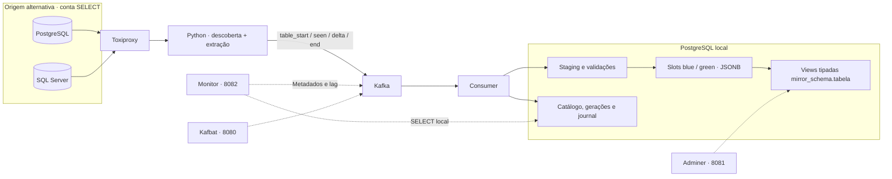
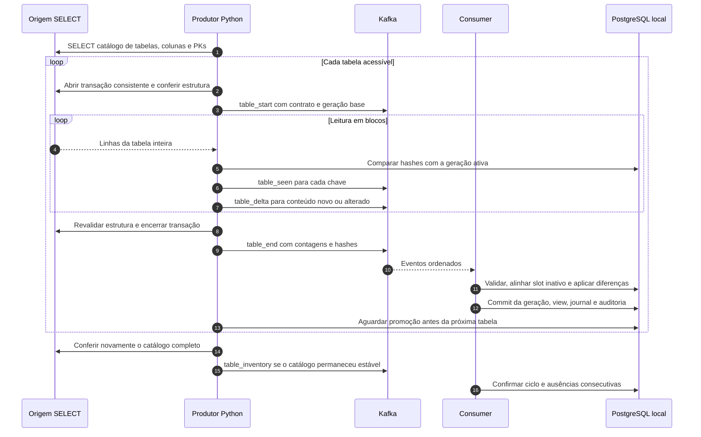

# Kafka Restore Lab

Laboratório de descoberta e reconciliação de tabelas de uma origem PostgreSQL ou SQL Server para PostgreSQL local, com Python, Kafka e publicação blue-green por tabela. A aplicação usa uma conta com **SELECT na origem**: não instala triggers, não habilita CDC, não cria tabelas de controle remotas e não executa DDL ou DML remoto.

```bash
docker compose up -d --build
```

Esse comando inicia o cenário PostgreSQL, prepara o proxy, descobre as tabelas, publica o bootstrap das tabelas ainda não inicializadas, aguarda a promoção pelo consumer e inicia o scheduler. O monitor faz parte do conjunto padrão: [localhost:8082](http://localhost:8082).

Os bancos de origem do Compose são fixtures com dados fictícios. A reconciliação padrão **lê integralmente cada tabela a cada ciclo**. O laboratório não foi homologado para produção ou bases de centenas de gigabytes.

## Arquitetura



Cada tabela tem um contrato de colunas, uma chave, suas próprias gerações e um slot ativo. As views ficam em `mirror_<schema da origem>.<tabela>`, por exemplo `mirror_public.contracts` e `mirror_dbo.invoices`. Nomes de schema ou tabela muito longos recebem um sufixo derivado do nome original para evitar colisões.

A view legada `public.contracts` continua disponível para os comandos antigos, mas **não é o destino do fluxo padrão de descoberta**. Uma instalação existente passa a ter as novas views sem apagar os dados anteriores.

### O que acontece em cada ciclo



Com PK simples ou composta, cada linha recebe uma identidade derivada dos valores da chave. O produtor lê todo o conteúdo remoto para comparar hashes; envia pelo Kafka os eventos de presença e os payloads divergentes. Isso reduz payloads de dados, **não a leitura da origem**.

Sem PK, publica uma cópia completa por ciclo, incluindo duplicatas, com identidade interna por posição. O resultado representa o snapshot, mas não permite atribuir de forma confiável cada diferença a INSERT, UPDATE ou DELETE. Nesses lotes, as contagens individuais ficam desconhecidas após o bootstrap.

### Operações atendidas

| Operação na origem | Comportamento do fluxo padrão |
| --- | --- |
| CREATE TABLE desconhecida | Descoberta no próximo catálogo, desde que visível e acessível à conta de leitura; gera nova view após bootstrap validado. |
| INSERT em tabela nova ou conhecida | Publicado após leitura e validação da tabela. |
| UPDATE | Conteúdo divergente substitui a linha da mesma PK. Sem PK, nova cópia completa. |
| DELETE físico | A ausência de uma chave na leitura completa remove a linha do destino, respeitando a guarda de exclusão. |
| ADD / DROP COLUMN | Mudança de contrato exige cópia completa e recriação transacional da view. |
| ALTER COLUMN | Detecta mudanças observáveis no tipo, tamanho, precisão, escala, nulabilidade e collation; valida a conversão local antes de publicar. |
| DROP TABLE | Após dois ciclos com catálogos completos e estáveis sem o objeto, remove apenas a view gerenciada; mantém dados internos e histórico. |

Uma mudança estrutural usa o slot inativo. Se a conversão, a validação ou a substituição da view falhar, a publicação anterior permanece disponível. Dependências externas podem impedir a troca de schema: usamos `RESTRICT`, sem apagar objetos dependentes. Objetos locais sem a marca de propriedade do laboratório não são sobrescritos.

O status de retirada é `missing_or_inaccessible`: com SELECT e metadados limitados, a ausência pode significar DROP **ou perda de visibilidade/permissão**. Uma tabela ainda visível no catálogo, mas sem SELECT, fica `inaccessible`, gera alerta e preserva a última publicação. Falhas de conexão, erro ao ler o catálogo ou catálogo diferente entre o início e o fim do ciclo não autorizam uma decisão de retirada. No SQL Server, a visibilidade dos metadados depende das permissões sobre os objetos, conforme a [documentação da Microsoft](https://learn.microsoft.com/en-us/sql/relational-databases/security/metadata-visibility-configuration?view=sql-server-ver16).

## Acesso à origem e consistência

A conta de extração precisa conectar ao banco e executar SELECT nas tabelas desejadas, inclusive nas criadas depois. No PostgreSQL também precisa de USAGE nos schemas. `SOURCE_SCHEMAS`, quando definido, limita a descoberta a uma lista de schemas separados por vírgula. Mantenha esse escopo estável: retirar um schema do filtro fará suas tabelas anteriormente conhecidas entrarem no fluxo de ausência.

A aplicação não concede permissões remotas. O administrador da origem deve provisioná-las. As fixtures incluem configurações administrativas apenas para facilitar os testes:

- PostgreSQL: `remote_reader` recebe SELECT na tabela inicial e permissões padrão para tabelas futuras criadas pelo administrador da fixture em `public`. Isso não abrange automaticamente outros proprietários ou schemas.
- SQL Server: `remote_reader` recebe SELECT no schema `dbo`, sem permissões de escrita ou administração.
- Scripts de inicialização do PostgreSQL só executam em volumes novos. Num volume antigo, o administrador da fixture pode precisar conceder SELECT nas novas tabelas; o sincronizador não fará isso.

No PostgreSQL, a leitura usa `REPEATABLE READ READ ONLY`. No SQL Server, usa SNAPSHOT quando já habilitado; caso contrário, SERIALIZABLE. Não executa `ALTER DATABASE` para habilitar isolamento. SERIALIZABLE mantém bloqueios de leitura até o fim da transação e pode bloquear escritores; considere esse custo ao dimensionar a leitura, conforme a [documentação de isolamento do SQL Server](https://learn.microsoft.com/en-ie/sql/t-sql/statements/set-transaction-isolation-level-transact-sql?view=sql-server-ver16).

`BEGIN`, `SET` de sessão e `COMMIT`/`ROLLBACK` controlam a transação de leitura; não exigem permissão de escrita sobre os dados. As consultas de catálogo e conteúdo são SELECT. Cada tabela usa uma transação independente: não há snapshot simultâneo de todo o banco.

## Tutorial PostgreSQL

Requisitos: Docker Engine ou Docker Desktop com Compose que suporte `!reset` para os testes isolados; portas locais disponíveis e memória para Kafka e os bancos. As interfaces são publicadas somente em `127.0.0.1`.

### 1. Iniciar e conferir

```bash
docker compose up -d --build
docker compose ps -a
docker compose logs --tail 30 init scheduler consumer
docker compose run --rm cli discover status
```

`init` deve terminar com código zero. O scheduler depende desse sucesso e executa ciclos com intervalo de 60 segundos **após concluir o ciclo anterior**. Reiniciar a aplicação não repete bootstrap de tabelas já inicializadas; compara a publicação existente. Tabelas novas recebem seu próprio bootstrap.

```bash
docker compose exec local-db psql -U postgres -d lab_local -c 'SELECT count(*) FROM mirror_public.contracts;'
```

A fixture inicial contém 10.000 contratos. Consulte o monitor, o [Kafbat](http://localhost:8080) e o [Adminer](http://localhost:8081). No Adminer: sistema PostgreSQL, servidor `local-db`, usuário `postgres`, senha `lab-admin`, banco `lab_local`.

### 2. Descobrir uma tabela e sincronizar alterações

As operações de escrita abaixo são executadas pelo administrador **da fixture descartável**, não pela conta de extração.

```bash
docker compose exec -T remote-db psql -v ON_ERROR_STOP=1 -U postgres -d lab_remote <<'SQL'
CREATE TABLE public.invoices (
  id BIGINT PRIMARY KEY,
  description TEXT,
  amount NUMERIC(14,2)
);
INSERT INTO public.invoices SELECT g, 'item ' || g, g FROM generate_series(1,10) g;
SQL
```

Aguarde o próximo ciclo ou pare o scheduler para executar ciclos manuais, evitando dois produtores simultâneos:

```bash
docker compose stop scheduler
docker compose run --rm cli discover once
docker compose exec local-db psql -U postgres -d lab_local -c 'TABLE mirror_public.invoices;'
```

```bash
docker compose exec -T remote-db psql -v ON_ERROR_STOP=1 -U postgres -d lab_remote <<'SQL'
INSERT INTO public.invoices VALUES (11, 'new', 12.50);
UPDATE public.invoices SET amount=42.25 WHERE id=1;
DELETE FROM public.invoices WHERE id=2;
ALTER TABLE public.invoices ADD COLUMN currency VARCHAR(3) DEFAULT 'BRL';
ALTER TABLE public.invoices ALTER COLUMN amount TYPE NUMERIC(16,4);
SQL
docker compose run --rm cli discover once
docker compose exec local-db psql -U postgres -d lab_local -c 'TABLE mirror_public.invoices;'
```

### 3. Retirar uma tabela

```bash
docker compose exec remote-db psql -U postgres -d lab_remote -c 'DROP TABLE public.invoices;'
docker compose run --rm cli discover once
docker compose run --rm cli discover once
docker compose run --rm cli discover status
docker compose start scheduler
```

A primeira ausência preserva a view. A segunda permite retirá-la. Não há remoção física dos arquivos históricos nem dos dados nos slots internos. Se o objeto reaparecer e puder ser lido, a reconciliação volta a publicar a view após validar os dados.

## Tutorial SQL Server

SQL Server é uma origem alternativa, compartilhando o mesmo consumer. Os exemplos abaixo usam o projeto atual; não rode o scheduler PostgreSQL durante o cenário SQL Server.

```bash
docker compose stop scheduler
docker compose --profile mssql --profile mssql-tools up -d --build remote-sqlserver local-db kafka toxiproxy consumer monitor
docker compose --profile mssql --profile mssql-tools run --rm mssql-fixture init
docker compose --profile mssql --profile mssql-tools run --rm mssql-cli discover init
docker compose exec local-db psql -U postgres -d lab_local -c 'SELECT count(*) FROM mirror_dbo.contracts;'
```

A fixture cria 100 contratos e uma conta de leitura. Ela usa `sa` para preparar exclusivamente o banco sintético; essas credenciais não são usadas pelo produtor. Para um ciclo manual ou acompanhamento:

```bash
docker compose --profile mssql --profile mssql-tools run --rm mssql-cli discover once
docker compose --profile mssql --profile mssql-tools run --rm mssql-cli discover status
docker compose --profile mssql --profile mssql-scheduled up -d --build mssql-scheduler
```

O scheduler SQL Server é opcional e deve ser iniciado depois de `discover init`. O comando padrão sem perfis continua sendo o cenário PostgreSQL. Use instâncias separadas do laboratório se precisar de destinos independentes; a identidade atual considera motor, schema e tabela, sem um identificador para múltiplos servidores do mesmo motor.

## Monitor: como interpretar

O painel mantém o cabeçalho com fluxo, horário de Fortaleza e atualização a cada 20 segundos. Os ícones `?` explicam cada indicador ao passar o mouse, tocar ou focar pelo teclado. As tabelas exibem **10 registros por página**, com total, primeira/anterior/próxima/última página. Cada tabela mantém sua própria navegação; a atualização automática preserva a URL selecionada. Os históricos apresentados continuam limitados às observações recentes carregadas pelo painel: 40 execuções e 20 observações de schema/faixas.

| Indicador | Significado |
| --- | --- |
| Última promoção | Tempo desde a última publicação validada de alguma tabela; não mede disponibilidade da origem. |
| Tabelas publicadas | Quantidade de réplicas com geração ativa; cada uma tem seu slot e contrato. |
| Lag Kafka | Diferença entre offsets publicados e confirmados pelo grupo. Inclui presença e controle, não equivale a linhas. |
| Cobertura de tabelas | Tabelas conhecidas ainda não retiradas com leitura completa validada na janela / total dessas tabelas. 80% significa 8 de 10 tabelas conferidas, não 80% dos dados ou bytes. |
| Falhas / rejeições | Lotes que falharam, foram abortados ou rejeitados nas últimas 24 horas. |
| Alterações promovidas | Contagens de INSERT + UPDATE + DELETE dos lotes confirmados com identidade conhecida. Não inclui atribuição individual em snapshots sem PK. |
| Catálogo de tabelas | Origem, view de destino, estado, linhas da última geração, slot, hash do schema, última conferência e erro. |

Uma tabela com falha mantém a última publicação válida e pode continuar contando na cobertura se foi conferida dentro da janela. Confira também o estado e a data: cobertura não substitui os alertas. No modo legado, a cobertura continua medindo faixas numéricas de PK, e usa o rótulo correspondente.

O monitor só lê auditoria local como `monitor_reader` e metadados Kafka. Não participa do grupo consumer nem acessa a origem. `/status.json` expõe os indicadores; `/run/<uuid>` mostra evidências do lote; `/healthz` informa que o processo HTTP está vivo; `/readyz` verifica leitura local e tópico Kafka, sem certificar igualdade entre bases.

Parâmetros do serviço `monitor`:

| Variável | Padrão | Efeito |
| --- | --- | --- |
| `LAB_SYNC_MODE` | `catalog` no Compose | Visão por tabela; `legacy` mostra faixas do fluxo antigo. |
| `LAB_COVERAGE_WINDOW_HOURS` | `24` | Janela de leituras validadas da cobertura. |
| `LAB_STALLED_MINUTES` | `15` | Alerta para lote pendente há muito tempo. |
| `LAB_MAX_CONSUMER_LAG` | `1000` | Limite do alerta de offsets pendentes. |
| `LAB_EXPECTED_INTERVAL_MINUTES` | `0` | Meta opcional de idade da última promoção; zero desabilita. |

## Componentes e serviços

| Serviço | Responsabilidade | Inicialização |
| --- | --- | --- |
| `remote-db` | PostgreSQL sintético; provisiona dados e conta SELECT em volume novo. | Padrão |
| `local-db` | Destino PostgreSQL; slots, views, staging, auditoria e journal. | Padrão |
| `kafka` | Transporte ordenado de eventos, uma partição de dados, modo KRaft. | Padrão |
| `toxiproxy` | Intermedia conexão da origem e permite simular falhas de rede. | Padrão |
| `consumer` | Consome eventos, valida o lote e promove cada tabela transacionalmente. | Padrão |
| `init` | Prepara proxy, descobre tabelas, inicializa as novas e aguarda promoção. | Padrão, execução única |
| `scheduler` | Executa os ciclos PostgreSQL após `init`, sem sobrepor ciclos. | Padrão |
| `monitor` | Painel HTTP de evidências locais e metadados Kafka. | Padrão, porta 8082 |
| `kafbat` | Interface de tópicos, mensagens, grupos e offsets. | Padrão, porta 8080 |
| `adminer` | Interface de consultas aos bancos do laboratório. | Padrão, porta 8081 |
| `cli` | Comandos manuais PostgreSQL, diagnóstico e recuperação. | Perfil `tools`, ou `run cli` |
| `seed-fixture` | Gerador administrativo de massa PostgreSQL sintética. | Perfil `tools` |
| `remote-sqlserver` | Origem SQL Server Developer sintética. | Perfil `mssql` |
| `mssql-fixture` | Prepara e modifica a fixture SQL Server como administrador. | Perfil `mssql-tools` + `mssql` |
| `mssql-cli` | Comandos de descoberta e sincronização SELECT para SQL Server. | Perfil `mssql-tools` + `mssql` |
| `mssql-scheduler` | Reconciliação periódica SQL Server, iniciada após bootstrap manual. | Perfil `mssql-scheduled` + `mssql` |

| Arquivo | Responsabilidade |
| --- | --- |
| `app/lab.py` | CLI, transporte Kafka, consumer e integração com o fluxo legado. |
| `app/discovery_catalog.py` | Catálogos PostgreSQL/SQL Server, permissões observáveis, identificadores, mapeamento de tipos e leitura consistente. |
| `app/discovery_sync.py` | Orquestra descoberta, comparação, publicação, espera da promoção e scheduler. |
| `app/discovery_store.py` | Schema local automático, staging por tabela, views tipadas, slots, journal, promoção, retirada e rollback. |
| `app/monitor.py` | Consultas de auditoria, alertas, renderização HTML, paginação e tooltips. |
| `app/startup.py` | Inicialização compatível com o fluxo legado de contratos. |
| `app/schema_evolution.py` | Planejamento, aprovação e backfill de schema no fluxo legado. |
| `app/source_catalog.py` | Observador explícito de um objeto no catálogo legado. |
| `app/canonical_contract.py` | Representação canônica dos contratos legados entre motores. |
| `app/mssql_sync.py` | Extração SQL Server do contrato legado e configuração de seu proxy. |
| `app/sqlserver_fixture.py` | Ações administrativas restritas à fixture SQL Server. |
| `sql/local.sql` | Estrutura inicial local e conta de leitura do monitor. |
| `sql/remote.sql` | Fixture PostgreSQL, dados iniciais e concessões SELECT. |
| `tests/` | Contratos offline e cenários integrados em projetos descartáveis. |

As tabelas `replica.discovered_tables`, `discovered_cycles`, `discovered_runs` e `discovered_schema_history` guardam o catálogo e a auditoria. `discovered_blue`/`discovered_green` guardam payloads JSONB; `discovered_seen`/`discovered_delta` são staging descartado ao concluir o lote; `discovered_generations` e `discovered_journal` sustentam a linhagem. A criação dessas estruturas é automática, inclusive em um volume local existente.

## Configuração, recuperação e limites

Comandos usuais, com o scheduler parado quando houver um produtor manual:

```bash
docker compose run --rm cli discover once --batch-size 250 --promotion-timeout 600
docker compose run --rm cli discover status
docker compose run --rm cli discover rollback --db-schema public --table contracts
```

O rollback alterna para a geração anterior somente quando o schema é compatível. O próximo ciclo volta a reconciliar a origem atual. Schema incompatível bloqueia rollback; uma atualização não é uma migração reversível automática. Pare o scheduler para inspecionar o estado restaurado.

Uma guarda rejeita lotes com remoção acima de `MAX_REMOVE_FRACTION` (padrão `0.20`, configurado no **consumer**). Isso também se aplica a exclusões físicas legítimas: numa tabela de três linhas, excluir uma supera 20%. Sem PK, a guarda usa a redução líquida da contagem. Uma rejeição preserva a publicação anterior. Ajustar o limite exige recriar o consumer com a configuração escolhida e iniciar uma nova leitura após revisar a origem.

Um lote pendente é retomado aguardando o consumer, sem republicar bootstrap. Se uma publicação foi interrompida antes de `table_end`, examine Kafka, logs e auditoria antes de abandonar:

```bash
docker compose logs --tail 80 consumer scheduler init
docker compose run --rm cli discover abandon --run-id UUID_DO_LOTE --force
```

O abandono publica um evento de controle ordenado. `--force` só deve ser usado após verificar se um END já está na fila. Falhas de catálogo inicial ou final ficam registradas como ciclos falhos; não autorizam retirar tabelas.

`DISCOVERY_THROTTLE_MS` pausa entre blocos de extração; `--batch-size` limita as linhas de cada bloco, não o tamanho total da leitura. `SOURCE_SCHEMAS` e o throttle devem ser configurados no serviço que publica (`init`, `scheduler` ou CLI). Origem remota usa `REMOTE_DSN` no PostgreSQL e `MSSQL_HOST`, `MSSQL_PORT`, `MSSQL_DATABASE`, `MSSQL_USER`, `MSSQL_PASSWORD` no SQL Server.

Tipos comuns geram colunas tipadas nas views. Valores são transportados como texto ou NULL para preservar precisão numérica; binários usam hexadecimal. Tipos sem correspondência segura permanecem como texto. Datas/horas SQL Server com sete casas fracionárias ficam como texto para preservar a última casa. Não são recriados índices, FKs, defaults de escrita, sequences, identidades, triggers ou permissões da origem. As views de réplica são para leitura.

Colunas com nomes acima do limite local de 63 bytes são bloqueadas explicitamente. Texto com NUL, conversões inválidas, permissões insuficientes e mensagens acima do limite do transporte interrompem o lote; não há promoção parcial. Tipos especializados podem exigir um mapeamento adicional. Não há garantia de equivalência de collation ou de todas as operações SQL entre motores.

A leitura completa, os eventos de presença, os dois slots e o journal têm custo de rede, armazenamento e processamento. O journal e a auditoria da descoberta não têm retenção automática nesta implementação. Polling não observa necessariamente todas as mudanças intermediárias entre ciclos, nem um CREATE seguido de DROP antes da próxima leitura. Não existe SLA de atualização ou igualdade global simultânea.

Para parar sem apagar volumes:

```bash
docker compose stop
docker compose up -d --build
```

Os schedulers terminam o ciclo atual ao receber SIGTERM, dentro do prazo de parada do Compose. `docker compose down` preserva volumes; adicionar `-v` apaga os dados do laboratório.

## Compatibilidade com os comandos anteriores

`initialize`, `bootstrap`, `incremental`, `schedule`, `status`, `rollback`, `schema` e `catalog` continuam disponíveis para o contrato fixo `public.contracts`. Esse fluxo usa faixas numéricas de ID e seus próprios metadados; não é o scheduler padrão. Para executá-lo manualmente, pare o scheduler de descoberta e use explicitamente os comandos antigos. Não misture os dois fluxos como se tivessem o mesmo checkpoint ou a mesma view.

Os comandos `chaos` continuam disponíveis para o proxy. Exemplo PostgreSQL: `docker compose run --rm cli chaos down`, seguido de `chaos up`. As ações `seed`, `mutate`, `load` e os comandos da fixture SQL Server modificam dados sintéticos com credenciais administrativas; não são mecanismos de sincronização nem devem apontar para uma origem real.

## Verificações

Testes offline, sem bancos ou Kafka:

```bash
python3 tests/check_static.py
python3 tests/test_discovery_catalog.py
python3 tests/test_monitor.py
python3 tests/test_startup.py
python3 tests/test_reconcile.py
python3 tests/test_generation_paths.py
python3 tests/test_schema_contract.py
python3 tests/test_source_catalog.py
python3 tests/test_mssql_contract.py
python3 tests/test_mssql_paths.py
```

Integração dos dois motores em projetos descartáveis, sem publicar portas do host:

```bash
LAB_DISCOVERY_TEST=1 bash tests/e2e_discovery.sh
# Ou apenas um motor:
LAB_DISCOVERY_TEST=1 LAB_DISCOVERY_ENGINE=postgresql bash tests/e2e_discovery.sh
LAB_DISCOVERY_TEST=1 LAB_DISCOVERY_ENGINE=sqlserver bash tests/e2e_discovery.sh
```

O teste valida início padrão, recusa de escrita pela conta SELECT, descoberta, INSERT/UPDATE/DELETE, rollback compatível, guarda de exclusão, ADD/ALTER COLUMN, bloqueio de rollback incompatível, PK composta, tabela sem PK, DROP seguro, evidências HTTP e paginação. O teste SQL Server desabilita SNAPSHOT na fixture para exercitar o fallback SERIALIZABLE sem permissão administrativa no produtor. Os recursos e volumes criados pelo teste são removidos ao terminar.

Para conferir promoção idempotente, limpeza de lotes abortados e distinção entre SELECT negado e catálogo ausente no armazenamento local, execute `docker compose exec -T -e LAB_DISCOVERY_STORE_TEST=1 consumer python - < tests/test_discovery_store_live.py`. Esse teste cria objetos dentro de uma transação e desfaz tudo com ROLLBACK; não acessa a origem.

Os demais scripts `tests/e2e_*.sh` mantêm experimentos específicos do fluxo legado. Leia a condição de ativação de cada script antes de executá-lo. `tests/e2e_startup.sh` verifica a compatibilidade da inicialização antiga; `tests/e2e_discovery.sh` verifica o caminho padrão atual.
